<!-- Last updated: 2026-09-22 10:08:16 (JST) -->
<!-- Author: Claude (Opus 4.8) / レビュー対象: tool/skl078.sh -->

# skl078.sh レビュー結果

## 0. 総評

シェル雛形として設計方針は良好です。特に次の点は評価できます。

- `set -e` を使わず、コマンド後に `rc=$?` で戻り値を手動キャプチャする方針（意図がコメント化されている）
- `tee` による端末出力とログの二重化
- ログ名に「日時 + ホスト名 + PID」を含め、並行実行でも衝突しない
- ヘッダに作成/更新時刻・作者・概要を記載

一方で、**古いログ削除が動作していない致命バグが1件**、ログ欠落を招きうる**堅牢性の穴が数件**あります。優先度順に以下へ整理します。

---

## 1. 指摘一覧（優先度順）

| # | 行 | 深刻度 | 分類 | 内容 |
|---|----|--------|------|------|
| 1 | 53 | **高（バグ）** | 機能不全 | `--delete` は存在しない。正しくは `-delete`。古いログ削除が毎回失敗している |
| 2 | 46, 49-51 | 中 | 堅牢性 | `exec > >(tee ...)` は終了時に `tee` を待たないため、末尾出力がログから欠落しうる |
| 3 | 19 | 中 | 堅牢性 | `set -u` 下で `$HOSTNAME` 未定義の実行環境（cron/一部の非対話シェル）だと即異常終了 |
| 4 | 53 | 低〜中 | 運用 | クリーンアップの失敗（find の戻り値）を検査していない。将来 `-delete` に直しても失敗を握り潰す |
| 5 | 14-15, 17 | 低 | 未使用 | `ERR` `WARN` `SCRIPT_DIR` が宣言のみで未使用。雛形の意図なら要コメント |
| 6 | 34 | 低 | 雛形 | `ls -l temp` はサンプルコード。相対パス `temp` 依存で、そのままだと失敗する旨を明記推奨 |
| 7 | 46 | 低 | 移植性 | プロセス置換 `>(...)` は bash 依存。shebang が bash なので現状は可。`sh` 移植時は不可 |

---

## 2. 各指摘の詳細

### #1 `--delete` は誤り（致命バグ）

```bash
# 現状（53行目）— 動作しない
find "${LOG_DIR}" -mtime +10 -name "${SCRIPT_NAME}.*.${HOSTNAME}.*.log" --delete
```

GNU find の述語は `-delete`（ハイフン1つ）です。`--delete` は未知の述語として

```
find: unknown predicate '--delete'
```

でエラー終了します。結果として、

- 10日より古いログが**一度も削除されていない**（放置でログが増え続ける）
- `exec` リダイレクト後の実行なので、この**エラーが毎回ログ本体に書き込まれる**

修正案：

```bash
# 修正版
find "${LOG_DIR}" -maxdepth 1 -type f \
     -name "${SCRIPT_NAME}.*.${HOSTNAME}.*.log" \
     -mtime +10 -delete
```

- `-maxdepth 1`：LOG_DIR 直下のみを対象にし、想定外の再帰削除を防止
- `-type f`：ディレクトリ誤爆の防止

> 補足（推測・要確認）：`-mtime +10` は「10日より前」を意味します。「10日以上経過」を厳密に狙うなら `+10` で概ね意図通りですが、境界の扱い（24時間単位・端数切り捨て）を許容できるかは運用要件しだいです。ここは意図に合っているか確認させてください。

### #2 `tee` を待たないことによるログ欠落

```bash
# 現状（46行目）
exec > >(tee "$LOG_PATH") 2>&1
```

プロセス置換で起動した `tee` は**バックグラウンドの別プロセス**です。メインスクリプトが `exit` した時点で `tee` のバッファがフラッシュされる保証がなく、**末尾の数行がログに残らない**ことがあります。特に大量出力の直後に終了する処理で顕在化します。

修正案（tee の PID を握って終了前に待つ）：

```bash
exec > >(tee "$LOG_PATH") 2>&1
tee_pid=$!                       # tee の PID を保持（末尾フラッシュ待ちに使用）

log "START"
main "$@"
RC=$?
log "END RC=${RC}"

find "${LOG_DIR}" -maxdepth 1 -type f \
     -name "${SCRIPT_NAME}.*.${HOSTNAME}.*.log" -mtime +10 -delete

exec 1>&- 2>&-                   # 自身の stdout/stderr を閉じ、tee に EOF を送る
wait "${tee_pid}" 2>/dev/null    # tee のフラッシュ完了を待機
exit ${RC}
```

### #3 `$HOSTNAME` の未定義リスク

```bash
# 19行目・53行目で参照
readonly LOG_NAME=${SCRIPT_NAME}.$(date '+%Y%m%d_%H%M%S').${HOSTNAME}.$$.log
```

`HOSTNAME` は bash が起動時に設定する変数ですが、cron や一部の非対話・最小環境では未設定・未エクスポートのことがあります。`set -u` 下で未定義参照すると**その場で異常終了**します。

修正案（外部コマンドで確実に取得）：

```bash
readonly HOSTNAME_S=${HOSTNAME:-$(hostname -s 2>/dev/null || echo unknown)}
readonly LOG_NAME=${SCRIPT_NAME}.$(date '+%Y%m%d_%H%M%S').${HOSTNAME_S}.$$.log
```

> `HOSTNAME` 自体を上書きすると読み手が混乱しうるため、別変数（例では `HOSTNAME_S`）を用意しています。命名は好みに合わせてください。

### #4 クリーンアップ失敗の握り潰し

`find ... -delete` の戻り値を検査していないため、権限不足などで削除に失敗しても気づけません。運用ログとして残すなら：

```bash
if ! find "${LOG_DIR}" -maxdepth 1 -type f \
        -name "${SCRIPT_NAME}.*.${HOSTNAME}.*.log" -mtime +10 -delete
then
  log "WARN: old log cleanup failed"   # 本処理の RC は汚さない
fi
```

### #5 未使用の宣言

`ERR` `WARN`（14-15行）、`SCRIPT_DIR`（17行）は宣言のみで本文中に使用箇所がありません。雛形として「呼び出し側が使う前提」であれば、その旨をコメントで明示すると誤解が減ります。使わないなら削除を推奨します。

### #6 サンプルコードの明示

`main()` 内の `ls -l temp`（34行）は雛形の動作確認用サンプルと見受けられます。相対パス `temp` に依存するため、そのまま実行すると失敗します。`# サンプル：ここに主処理を記述` 等のコメントで置換ポイントを明示すると親切です。

---

## 3. 処理フロー（現状）

```mermaid
flowchart TD
    A[起動] --> B[readonly 群を評価<br/>LOG_PATH 等を確定]
    B --> C["exec > >(tee LOG_PATH) 2>&1<br/>以降の全出力をログへ二重化"]
    C --> D["log START"]
    D --> E["main 呼び出し<br/>rc を手動キャプチャ"]
    E --> F["RC=&#36;? を退避"]
    F --> G["log END RC"]
    G --> H["find --delete<br/>※ここが失敗している"]
    H --> I["exit RC"]
    H -. 改善 .-> J["tee_pid を wait して<br/>末尾フラッシュ後に exit"]
```



---

## 4. まとめ

- **最優先**：`--delete` → `-delete`（#1）。これでログ肥大化とログ内エラー混入を同時に解消。
- **次点**：`tee` の待ち合わせ（#2）でログ欠落を防止、`$HOSTNAME` のフォールバック（#3）で実行環境依存を解消。
- 残り（#4〜#6）は雛形の可読性・安全性向上の観点。

方針自体は堅実なので、上記を反映すれば実運用に耐える雛形になります。修正版の全文が必要であれば、そのまま差し替えられる形で提示します。

---

### 参考：レビュー対象（抜粋・該当箇所）

```bash
# 46行目：ログ二重化（tee 待ち合わせなし）
exec > >(tee "$LOG_PATH") 2>&1

# 53行目：古いログ削除（--delete 誤り）
find "${LOG_DIR}" -mtime +10 -name "${SCRIPT_NAME}.*.${HOSTNAME}.*.log" --delete
```
