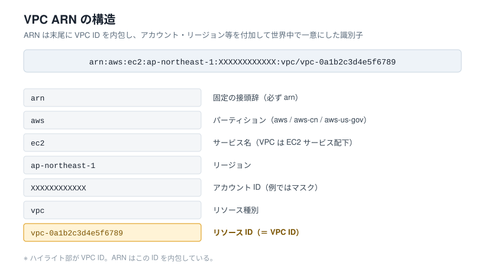

# VPC の ID と ARN の違い（まとめ）
<!-- Last updated: 2026-09-22 18:05:04（です・ます調に統一） -->

VPC の **ID** と **ARN** は、どちらも「特定の VPC を指し示す識別子」ですが、**一意性のスコープと用途**が異なります。

---

## 1. 違いの要点

| 観点 | VPC ID | VPC ARN |
|---|---|---|
| 形式 | `vpc-0a1b2c3d4e5f6789` | `arn:aws:ec2:ap-northeast-1:XXXXXXXXXXXX:vpc/vpc-0a1b2c3d4e5f6789` |
| 一意性の範囲 | **リージョン内**で一意 | **AWS 全体（パーティション横断）**で一意。アカウント ID・リージョンまで含む |
| 含まれる情報 | VPC のリソース ID のみ | パーティション・サービス名・リージョン・アカウント ID・リソース種別・リソース ID |
| 主な用途 | 各種 API 呼び出し、Terraform でのリソース参照（`aws_vpc.main.id`） | IAM ポリシーのリソース指定、リソースレベルの権限制御、クロスアカウント参照、タグ付け API など |
| 長さ | 短い | 長い（情報が多い） |

---

## 2. ARN の構造

ARN（Amazon Resource Name）は、AWS のあらゆるリソースを一意に表すための「住所」のような形式です。VPC の ARN は次のセグメントで構成されます。



ポイントは、**ARN は末尾に VPC ID を内包している**ことです。
つまり「VPC ID に、それがどのアカウント・リージョン・サービスのものかという情報を付け足して、世界中で一意にしたもの」が VPC ARN、というイメージです。

---

## 3. 使い分けのイメージ

- **VPC ID** … 同じアカウント・同じリージョン内での操作で使う日常的な識別子です。
  サブネットの `vpc_id`、ルートテーブルの紐付けなど、Terraform のリソース間参照はほぼこちらを使います。
- **VPC ARN** … 「誰の・どこの」リソースかまで明示する必要がある場面で使う識別子です。
  代表例は IAM ポリシーの `Resource` 指定です。

### IAM ポリシーでの利用例

```json
{
  "Effect": "Allow",
  "Action": "ec2:DeleteVpc",
  "Resource": "arn:aws:ec2:ap-northeast-1:XXXXXXXXXXXX:vpc/vpc-0a1b2c3d4e5f6789"
}
```

ID だけでは「どのアカウントの VPC か」を表現できないため、権限制御では ARN が必要になります。

---

## 4. Terraform での扱い

`id`（VPC ID）と `arn`（VPC ARN）は、**どちらも作成後に出力される参照専用の Attribute** です（設定はできません）。
他リソースへ渡す際は、用途に応じて使い分けます。

```hcl
# VPC ID を参照する例（サブネットの紐付け）
resource "aws_subnet" "main" {
  vpc_id     = aws_vpc.main.id          # リージョン内の識別子で十分なケース
  cidr_block = var.subnet_cidr
}

# VPC ARN を参照する例（IAM ポリシー文書など。例示であり、本プロジェクトのポリシーは jsonencode で記述）
data "aws_iam_policy_document" "vpc_policy" {
  statement {
    effect    = "Allow"
    actions   = ["ec2:DeleteVpc"]
    resources = [aws_vpc.main.arn]      # アカウント・リージョンまで含む識別子が必要なケース
  }
}
```

---

> 注記: 上記の ARN 例に含まれるアカウント ID（`XXXXXXXXXXXX`）・リージョン（`ap-northeast-1`）・VPC ID（`vpc-0a1b2c3d4e5f6789`）は、すべて説明用のマスク／サンプル値です。実環境ではご利用中のアカウント・リージョン・実 ID に置き換わります。
