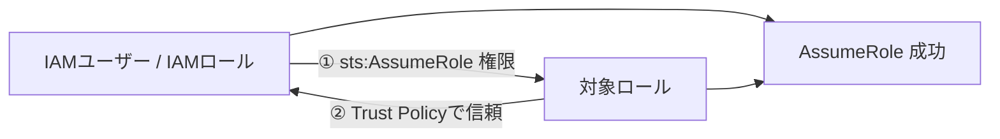
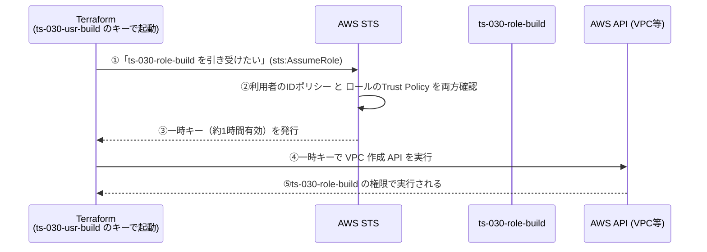

<!-- Last updated: 2026-09-22 18:03:44（です・ます調に統一し対応関係の表現を変更） -->
# AWS AssumeRole の仕組みまとめ（権限を期間限定で借りる仕組み）

AssumeRole は、**自分の権限ではなく、別の権限セットを「期間限定で借りて」、その間だけその権限で動く**仕組みです。本プロジェクトの認証の中心になっているため、ここで丁寧に説明します。

関連：[IAM最小権限の仕組み.md](IAM最小権限の仕組み.md) / [運用ユーザーと再作成手順.md](運用ユーザーと再作成手順.md)

---

## 1. AssumeRole とは

`sts:AssumeRole` は、**別の IAM ロールを一時的に引き受け、そのロールの権限で AWS を操作する仕組み**です。

AssumeRole が成功すると、一時的な認証情報（AccessKeyId・SecretAccessKey・SessionToken）が発行され、その認証情報を使って AWS を操作します。借りた権限は**約1時間で自動失効**します（＝一時キー）。**強い権限をずっと持ち歩かない**のが狙いです。

---

## 2. たとえ話：貸出バッジ

会社の入退室にたとえると分かりやすくなります。

| 登場人物 | たとえ | 本プロジェクトでの対応 |
|----------|--------|------------------------|
| IAM ユーザー | **あなた自身**。自分の社員証を持つが、開けられるドアはごくわずか | `ts-030-usr-build`（`sts:AssumeRole` だけ持つ） |
| IAM ロール | 壁に掛かった**作業用の貸出バッジ**。持ち主はおらず、特定のドアだけ開く | `ts-030-role-build`（6サービスだけ操作可） |
| AssumeRole | 受付で社員証を見せ、**時間制限つきで貸出バッジを借りる**こと | provider が起動時に行う |

---

## 3. 成立には「両側の鍵」が必要（最重要）

AssumeRole は、**2つの許可が両方そろって初めて**成立します。片方だけでは借りられません。

| 鍵 | どこに書くか | 内容 |
|----|--------------|------|
| ① 借りる側の許可 | ユーザー `ts-030-usr-build` の **IDポリシー** | 「私は `sts:AssumeRole` してよい」 |
| ② 貸す側の許可 | ロール `ts-030-role-build` の **Trust Policy（信頼ポリシー）** | 「この相手になら貸してよい」 |



> 「両側に鍵がかかったドア」をイメージしてください。利用者側（①）とロール側（②）の**両方が開いて**初めて通れます。

本プロジェクトでは、① は `ts-030-usr-build` に付与済み、② は「同一アカウント内なら可（ルート信頼）」です。両方OKなので引き受けられます。

---

## 4. 実際の流れ



ポイントは ④⑤ です。**Terraform は VPC を作る間、`ts-030-usr-build` 自身の権限ではなく、借りた `ts-030-role-build` の権限で動いています。**

---

## 5. AssumeRole できる主体 / できないもの

| 主体 | 可否 |
|------|------|
| IAM ユーザー | 可能 |
| IAM ロール | 可能（ロールチェーン） |
| IAM グループ | **実行主体にはなれない**（所属ユーザーへ権限を付与するための入れ物） |

AssumeRole 後は、**引き受けたロールの権限**で AWS を操作します（自分の権限は使われません）。

---

## 6. Terraform 上での書き方

`infra/provider.tf` の `assume_role` ブロックがこの「借りる」設定です。

```hcl
provider "aws" {
  region  = var.aws_region
  profile = var.assume_profile   # = ts-030-usr-build（起点のユーザー）

  # ここで構築ロールを「借りる」
  assume_role {
    role_arn = "arn:aws:iam::${var.aws_account_id}:role/${var.build_role_name}"
    #          = ts-030-role-build を引き受ける
  }
}
```

- `profile` … **借りに行く人**（`ts-030-usr-build`）です。
- `assume_role.role_arn` … **借りるバッジ**（`ts-030-role-build`）です。
- bootstrap 側（`infra/bootstrap/provider.tf`）には `assume_role` ブロックが**ありません**。構築ロールを「作る」工程なので、借りずに `ts-030-usr-role-admin` で直接実行します。
- `infra/backend/provider.tf`（state バケットの作成）も infra と同じ構成で構築ロールを借ります。

### state を読み書きする backend も同じロールを借りる

`infra/provider.tf` の `terraform {}` 内にある `backend "s3"`（state の保存先）も、provider とは別に同じ構築ロールを借りて S3 にアクセスします。

```hcl
backend "s3" {
  bucket       = "ts-030-bkt-tfstate"
  key          = "infra/terraform.tfstate"
  profile      = "ts-030-usr-build"                                        # 借りに行く人
  assume_role  = { role_arn = "arn:aws:iam::<アカウントID>:role/ts-030-role-build" }  # 借りるバッジ
  use_lockfile = true
  # region / encrypt は省略
}
```

- backend ブロックは変数を使えないため、値を直書きしています（provider は `var.*` を使えます）。
- provider の `assume_role` は**ブロック**、backend の `assume_role` は**オブジェクト属性**（`= { ... }`）で書きます。
- state へのアクセスにも構築ロールが要るため、**構築ロールが無い間（bootstrap 破棄中）は `terraform init`/`plan` で state も読めません**。

---

## 7. 本プロジェクトの3ユーザーの例

### `ts-030-usr-build`（infra 実行）

`sts:AssumeRole` により `ts-030-role-build` を引き受けられます。このユーザー自体には AWS リソースを操作する権限はなく、実際の権限は引き受けた `ts-030-role-build` のポリシーで決まります。

### `ts-030-usr-role-admin`（bootstrap 実行）

`ts-030-*` ロールに対して以下を実行できます。

- CreateRole / DeleteRole / GetRole / Tag・Untag
- Put/Delete/Get/ListRolePolicies、ListAttachedRolePolicies
- ListInstanceProfilesForRole（Terraform がロール削除前に確認するため必要）

以下は**許可されていません**（権限昇格経路を持たせないため）。

- AssumeRole / PassRole
- AttachRolePolicy / DetachRolePolicy / UpdateAssumeRolePolicy

### `ts-030-usr-operate`（データ運用）

`sts:AssumeRole` で `ts-030-role-operate` だけを引き受けられます。CLI では `~/.aws/config` に次のプロファイルを定義し、`--profile ts-030-role-operate` を付けるだけで CLI が自動で AssumeRole します（一時キーの取得・更新も CLI が行います）。`tool/upl-run.sh`・`pop-s3.sh`・`del-s3.sh`・`get-now.sh` はこのプロファイルを使います。

```ini
# role_arn = 借りるバッジ（Terraform の assume_role.role_arn に対応）
# source_profile = 借りに行く人（Terraform の profile に対応）
# ※ config ファイルでは値の後ろにコメントを書けない（値の一部になる）ため、コメントは別の行に書く
[profile ts-030-role-operate]
role_arn       = arn:aws:iam::<アカウントID>:role/ts-030-role-operate
source_profile = ts-030-usr-operate
region         = ap-northeast-1
```

引き受けたロールで in/out バケットのオブジェクト操作のみを行い、構築ロールは引き受けられないため、インフラの破棄・再作成はできません（構築と運用の分離）。

---

## 8. なぜこんな回りくどいことをするか

| 観点 | 効果 |
|------|------|
| 起点ユーザーが弱い | `ts-030-usr-build` のキーが漏れても、できるのは「ロールを引き受ける」ことだけ。VPC を直接消したりはできない |
| 借りる先も絞ってある | `ts-030-role-build` も6サービス限定。つまり**二重に絞られている** |
| 一時キー | 借りた権限は期限つき。**強い権限を恒久キーとして持ち歩かない**ので、漏洩時の被害が小さい |

> つまり AssumeRole は「強い権限を常時持たず、必要なときだけ・期限つきで借りる」ための仕組みであり、最小権限・漏洩対策の中心になっています。

---

## 9. よくある誤解

| 誤解 | 正しい理解 |
|------|------------|
| 「ロールに権限があれば誰でも使える」 | 違う。**Trust Policy で許可された相手**しか引き受けられない（②の鍵） |
| 「ユーザーに AssumeRole 権限があれば必ず引き受けられる」 | 違う。**ロール側の Trust Policy** も許可していないと不可（両側の鍵） |
| 「引き受けても自分の権限のまま」 | 違う。引き受けている間は**ロールの権限**で動く（自分の権限は使われない） |
| 「一度借りたらずっと使える」 | 違う。一時キーには**有効期限**があり、切れたら再取得が必要 |

---

## 10. 重要ポイント（要約）

- AssumeRole は別ロールの権限を一時的に借りる仕組みです。
- 呼び出し側には `sts:AssumeRole` 権限が必要です（①）。
- 対象ロールには Trust Policy が必要です（②）。**両方が揃って初めて成功**します。
- AssumeRole 後は引き受けたロールの権限で操作します。
- 借りた権限は一時キー（期限つき）で、漏洩時の被害が小さくなります。
- IAM グループは AssumeRole の実行主体ではありません。
