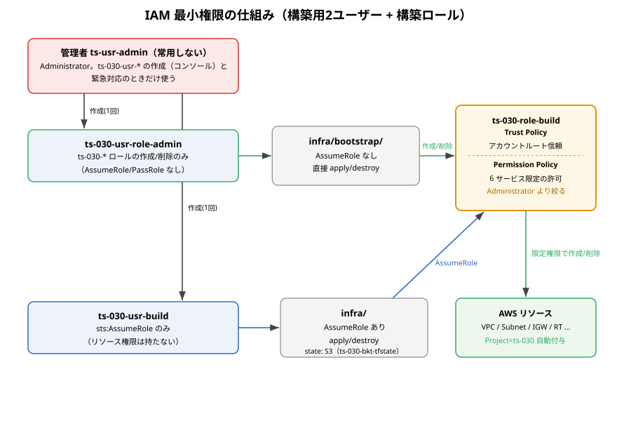
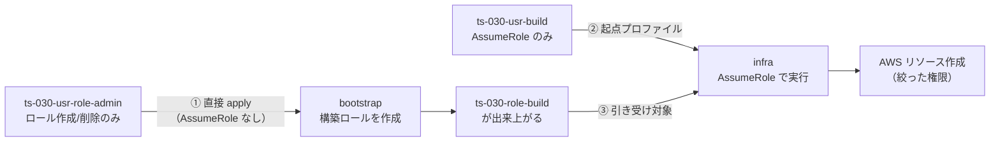
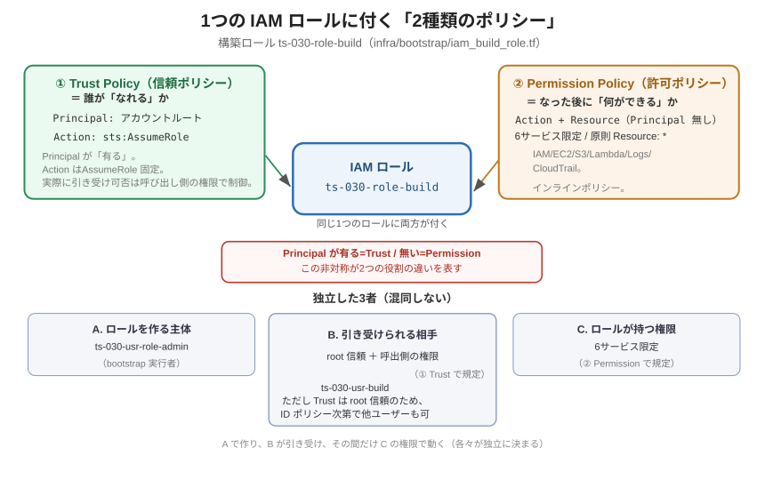

<!-- Last updated: 2026-09-22 18:05:30（新規設計の文書として書き換え・です/ます調に統一） -->
# IAM 最小権限の仕組み（インフラ構築時）

本プロジェクトのインフラ構築（`terraform apply`）が、**管理者権限を常用せず、絞った権限で実行される**仕組みと、その中核である**構築ロール（`ts-030-role-build`）の設計**をまとめます。

対象コード：

- `infra/bootstrap/iam_build_role.tf` … 構築ロール `ts-030-role-build` の定義
- `infra/bootstrap/provider.tf` … bootstrap 側 provider（`ts-030-usr-role-admin` で直接実行）
- `infra/provider.tf` … infra 本体 provider（`ts-030-usr-build` が AssumeRole で構築ロールを引き受け）。state 用の `backend "s3"` も同じロールを引き受ける
- `infra/backend/provider.tf` … state バケット用 provider（infra と同じく `ts-030-usr-build` → 構築ロール）

> 本書は **構築ロールの仕組みと設計**を説明します。実行ユーザー（`ts-030-usr-role-admin` / `ts-030-usr-build` / `ts-030-usr-operate`）の運用と破棄・再作成手順は [運用ユーザーと再作成手順.md](運用ユーザーと再作成手順.md) を、AssumeRole 自体の一般的な仕組みは [AssumeRoleまとめ.md](AssumeRoleまとめ.md) を参照してください。

---

## 1. 何を「最小権限」にしているか

ポイントは「**誰が**」「**何を使って**」AWS を操作するかを 3 段階で絞っていることです。

| 段階 | 仕組み | 効果 |
|:----:|--------|------|
| ① 主体の分離 | 管理者を**常用しない**。<br />bootstrap は `ts-030-usr-role-admin`（ロール作成/削除のみ）が`ts-030-role-build`を作成<br />infra は `ts-030-usr-build`（`sts:AssumeRole` のみ）が構築ロール `ts-030-role-build` を引き受けて実行 | 用途別に最小権限ユーザーを分け、認証情報漏洩時の被害範囲を限定できる |
| ② 権限の絞り込み | 構築ロールの権限を Administrator ではなく、**6 サービス・必要アクションのみ**に限定 | 想定外のサービス（課金リスク・情報漏洩）を触れない |
| ③ 信頼範囲の制御 | 構築ロールの **Trust Policy** で「誰が引き受けられるか」を定義 | 任意のプリンシパルがロールを乗っ取るのを防ぐ |

> 実行ユーザーの構成（`ts-030-usr-role-admin` / `ts-030-usr-build` / `ts-030-usr-operate` / `ts-usr-readonly` / `ts-usr-admin`）の詳細は [運用ユーザーと再作成手順.md](運用ユーザーと再作成手順.md) を参照してください。

---

## 2. 全体構成



実行は次の 3 ルートモジュールに分かれます。

| ルートモジュール | 実行主体 | provider 設定 | 役割 |
|------------------|----------|---------------|------|
| `infra/bootstrap/` | `ts-030-usr-role-admin`（ロール作成/削除のみ） | **AssumeRole なし**（直接実行） | 構築ロール `ts-030-role-build` を**作る／消すだけ** |
| `infra/` | `ts-030-usr-build`（`sts:AssumeRole` のみ）を起点に AssumeRole | **AssumeRole あり** | 構築ロール`ts-030-role-build`を引き受け、**絞った権限**で実リソースを作成・削除。state は S3（`ts-030-bkt-tfstate`） |
| `infra/backend/` | `ts-030-usr-build` を起点に AssumeRole | **AssumeRole あり** | infra の state バケット `ts-030-bkt-tfstate` を作成（常設・破棄対象外・自身の state はローカル） |

---

## 3. なぜ bootstrap が必要か（循環の解消）

「絞った構築ロールで構築する」方針には、**鶏と卵の循環**があります。

> 構築ロールを使って構築したいです。<br/>
> しかし、その構築ロール自身は誰が作るのか？<br/>
> 構築ロールで作ろうとすると「まだ存在しないロール」を引き受けることになり、実行できません。

これを解くのが **bootstrap（初期構築）** です。



- **bootstrap だけは AssumeRole せず**、`ts-030-usr-role-admin` で直接実行します（`infra/bootstrap/provider.tf` に `assume_role` ブロックがありません）。
- 構築ロールが出来た後は、**リソース構築は必ず infra 側**（`ts-030-usr-build` の AssumeRole 経由）で行います。
- どちらの工程でも **管理者 `ts-usr-admin` は使いません**（admin は `ts-030-usr-*` 3ユーザーの初期作成と緊急時のみ使います）。

---

## 4. 構築ロールの中身（`iam_build_role.tf`）

構築ロールには、役割の異なる**2種類のポリシー**が付きます。ここを分けて理解するのが要点です。



| ポリシー | 何を決めるか | 特徴 |
|:--|:--|:--|
| **Trust Policy（信頼ポリシー）** | 誰がこのロールに「なれる」か | `Principal` が**有る**。`Action` は `sts:AssumeRole` 固定 |
| **Permission Policy（許可ポリシー）** | ロールになった後に「何ができる」か | `Principal` が**無い**（ロール自身が主語）。`Action`＋`Resource` |

### 4-1. Trust Policy（誰が AssumeRole できるか）

Trust Policy は `infra/bootstrap/iam_build_role.tf` の `aws_iam_role.build` の `assume_role_policy` に `jsonencode` で定義しています。信頼先は**アカウントルート**です。アカウント ID は `data "aws_caller_identity"` で動的取得し、ハードコードしていません。

```hcl
assume_role_policy = jsonencode({
  Version = "2012-10-17"
  Statement = [{
    Effect    = "Allow"
    Principal = { AWS = "arn:aws:iam::${data.aws_caller_identity.current.account_id}:root" }
    Action    = "sts:AssumeRole"
  }]
})
```

設計意図は「ロール側はアカウントルートを信頼し、実際に引き受けられるかは呼び出し側のユーザーポリシーで制御する」ことです。つまり**二段構え**です。

- ロール側（Trust）は「同一アカウント内なら可」と広く開けます。ルート自体に無条件で開放しているわけではありません。
- **実際に引き受けられるか**は、呼び出し側プリンシパル（infra を実行する `ts-030-usr-build`）が `sts:AssumeRole` 権限を持つかで決まります。同ユーザーは AssumeRole 権限のみを持つため引き受けられます。

> Trust と Permission の違いは「`Principal` の有無」に表れます。Trust には「誰が」を表す `Principal` があり、Permission には無い（主語はロール自身）です。この非対称が2つの役割の違いそのものです。
>
> セキュリティを厳密化するなら、Principal をルートではなく `ts-030-usr-build` の ARN に限定する余地があります（[6. 現状の限界](#6-現状の限界と今後の絞り込み余地) の L-4）。

### 4-2. Permission Policy（何ができるか）

**形態：インラインポリシー**です。`resource "aws_iam_role_policy" "build"` でロールに直接埋め込み、`role = aws_iam_role.build.id` で紐付けます。管理ポリシー（`aws_iam_policy` + アタッチ）方式は使っていません。ポリシーが構築ロール専用で他から再利用しないため、ロールと一体で作成・削除されるインライン方式を選びました。

インラインポリシーで、**6 サービス + STS ユーティリティ**を Sid 単位に分けて許可しています。**原則 `Resource:"*"`、Condition なし**です。例外として S3 のオブジェクト操作の 3 Statement だけは ARN で限定しています（うち1つは Deny）。

| Sid | サービス | 主なアクション |
|-----|----------|----------|
| `IAMManagement` | IAM | CreateRole/DeleteRole/GetRole/**PassRole**、Policy 系、InstanceProfile 系（`ListInstanceProfilesForRole` を含む）、Tag |
| `EC2VPCManagement` | EC2 / VPC | VPC/Subnet/IGW/RouteTable/SG/KeyPair の Create/Delete/Describe、RunInstances、ENI 関連（※） |
| `S3Management` | S3 | Bucket/Policy/PublicAccessBlock/Encryption/Versioning/Lifecycle/Notification/Ownership 等 |
| `S3EmptyProjectBuckets` | S3 | `s3:DeleteObject`（`arn:aws:s3:::ts-030-*/*` に限定。`force_destroy` でバケットを空にするため。BUG-004） |
| `S3TerraformState` | S3 | `s3:GetObject` / `s3:PutObject`（`ts-030-bkt-tfstate/*` に限定。infra の state 読み書き） |
| `DenyStateHistoryDeletion` | S3 | **Deny** `s3:DeleteObjectVersion`（`ts-030-bkt-tfstate/*`。`S3Management` の許可より優先し、state の旧世代を消させない） |
| `LambdaManagement` | Lambda | CreateFunction/UpdateFunction、Add/RemovePermission、GetPolicy 等 |
| `CloudWatchLogsManagement` | CloudWatch Logs | LogGroup/RetentionPolicy/MetricFilter |
| `CloudTrailManagement` | CloudTrail | CreateTrail/Start・StopLogging 等 |
| `STSUtils` | STS | GetCallerIdentity のみ（疎通確認用） |

対象は実質 **6サービス**（IAM/EC2/S3/Lambda/Logs/CloudTrail）＋補助の STS です。当初は EventBridge と SNS の Sid も含めていましたが、終了処理を自己 terminate 方式にしたこと（EventBridge 不要。[終了処理の簡素化.md](終了処理の簡素化.md)）と SNS トピックを作らない決定により使わなくなったため、`EventBridgeManagement` と `SNSManagement` を 2026-09-22 に削除しました（SMS 送信の `sns:Publish` は Lambda/EC2 の実行ロール側にあり、影響しません）。

絞り込みの考え方：

- **サービスを列挙**：上記 6 サービス以外（RDS・DynamoDB・課金系・EventBridge・SNS など）は一切許可しません。
- **アクションを列挙**：各サービスでも `ec2:*` のようなワイルドカードを使わず、構築に必要なアクションのみを明示します。
- **Administrator は使わない**：`"Action": "*"` / `"Resource": "*"` の全許可ではなく、対象サービスを絞ることで「想定外の操作ができない」状態にしています。
- ただし大半の Sid の `Resource` は `"*"`・Condition なしです。**「サービス×アクション」では絞りますが「リソース ARN」では絞っていません**（例外は上記 S3 の 3 Statement）。ここは最小権限としては緩く、今後の厳密化（[7. IAM改善案](#7-iam改善案優先度付き)）の余地です。

> （※）`EC2VPCManagement` には `ec2:DescribeNetworkInterfaces` / `DetachNetworkInterface` / `DeleteNetworkInterface`（ENI 関連）を含みます。これは当初欠落しており、subnet の `destroy` 時に provider が呼ぶ ENI 確認で `UnauthorizedOperation` となって失敗しました。**「アクションを必要分だけ列挙する」方式の裏返しで、削除系が内部で呼ぶ付随 API を取りこぼすと destroy で初めて顕在化する**点に注意が必要です。詳細は [不具合一覧.md](不具合一覧.md) の BUG-001 です。同種の事例として、destroy 時の `iam:ListInstanceProfilesForRole` と `s3:DeleteObject`（バージョニング無効バケットの force_destroy）の欠落が BUG-004 です。

### 4-3. 「独立した3者」を混同しない

構築ロールをめぐって、次の3つは**それぞれ独立に決まります**（上記①〜③の3段階を、構築ロールという1つの主体に即して言い換えたものです）。

| 者 | 実体 | どこで決まるか |
|:--|:--|:--|
| A. ロールを**作る**主体 | `ts-030-usr-role-admin`（bootstrap 実行者） | bootstrap の実行権限 |
| B. ロールを**引き受けられる**相手 | root 信頼 ＋ 呼び出し側の ID ポリシー | Trust Policy |
| C. ロールが**持つ**権限 | 6サービス限定 | Permission Policy |

「A で作り、B が引き受け、その間だけ C の権限で動く」という関係です。**作る人・なれる人・できること**は別物、という点が IAM 理解の勘所です。

### 4-4. 宣言的な定義（Terraform）と手続き的な作成（CLI）

構築ロールは、Terraform の宣言的な**2リソース**で定義しています。

| Terraform リソース | 内容 | CLI で手続き的に作る場合の対応 |
|:--|:--|:--|
| `aws_iam_role.build` | ロール本体＋Trust Policy（`assume_role_policy`） | `aws iam create-role --assume-role-policy-document ...` |
| `aws_iam_role_policy.build` | インラインの Permission Policy（`role = aws_iam_role.build.id`） | `aws iam put-role-policy ...` |

CLI で作る場合は「既存の削除 → 作成 → ポリシー付与」の順序を手続きとして書く必要があります。Terraform では、作成・更新・削除のどれが必要かを state と実機の差分から自動判断し、依存関係は `role = aws_iam_role.build.id` の**参照**で表現されます。その代わり、差分検出のために実機の状態を読み取る権限が別途必要になります（次節）。

### 4-5. Terraform の状態管理のために必要になった権限

Terraform は、作成直後の read-after-write・`plan` 時の refresh・`destroy` 時の付随処理で、「作る」だけの CLI 操作より多くの `Describe/Get/List` 系や削除系の API を呼びます。構築と破棄を実際に行う中で、次の権限が必要と判明し追加しました（プレフィックスは変数 `prj_prefix` で `ts-030`）。

| Sid | 追加した主な権限 | 理由 |
|:--|:--|:--|
| IAMManagement | `iam:GetRolePolicy` | インラインポリシーの refresh |
| EC2VPCManagement | `ec2:DescribeNetworkInterfaces` / `DetachNetworkInterface` / `DeleteNetworkInterface`、`DescribeSecurityGroupRules`、`DisassociateRouteTable`、`Authorize/RevokeSecurityGroupEgress`、`DeleteTags` | destroy 時の ENI 掃除・SG ルール refresh 等（BUG-001） |
| S3Management | `GetBucketAcl` / `GetBucketCORS` / `GetBucketWebsite` / `GetAccelerateConfiguration` / `GetBucketRequestPayment` / `GetBucketLogging` / `GetReplicationConfiguration` / `GetBucketObjectLockConfiguration` | `aws_s3_bucket` の read-after-write（BUG-002） |
| LambdaManagement | `GetFunctionCodeSigningConfig` / `ListVersionsByFunction` / `GetRuntimeManagementConfig` | Lambda の read |
| CloudWatchLogsManagement | `ListTagsForResource` / `TagResource` / `UntagResource` | ロググループのタグ（ARN ベース API。WBS 2.8） |
| CloudTrailManagement | `GetTrailStatus` / `GetEventSelectors` / `GetInsightSelectors` / `ListTags` / `UpdateTrail` / `RemoveTags` | 証跡の refresh・更新（WBS 2.8） |
| IAMManagement | `iam:ListInstanceProfilesForRole` | ロール削除前の Instance Profile 確認（destroy。BUG-004） |
| S3EmptyProjectBuckets（新設） | `s3:DeleteObject`（`ts-030-*/*`） | `force_destroy` でのオブジェクト削除（destroy。BUG-004） |
| S3TerraformState / DenyStateHistoryDeletion（新設） | state バケットの Get/Put と旧世代削除の Deny | S3 バックエンド（改善対象 B-5） |
| EventBridgeManagement / SNSManagement（**削除**） | — | 自己 terminate 方式で EventBridge が不要、SNS トピックは作らないため不要（2026-09-22） |

> **宣言的ツールは、手続き的な CLI 操作より広い読み取り権限を要求する**点は重要な設計上の知見です。同じ「作る」でも、冪等性と差分検出のために多くの `Describe/Get` を呼びます。この権限不足は [不具合一覧.md](不具合一覧.md) の BUG-001・BUG-002 として記録済みです。新しいリソースを追加するときは、apply だけでなく再 plan と destroy まで通して権限を検証します。

---

## 5. 補助的な仕組み：default_tags

3つの provider（infra / bootstrap / backend）すべてに `default_tags` を設定し、作成する全リソースに `Project = ts-030` を自動付与しています（`provider.tf`）。

```hcl
default_tags {
  tags = { Project = var.project_tag }   # ts-030
}
```

- 直接の権限制御ではありませんが、**タグによるリソース識別・コスト集計・削除対象の特定**を確実にし、「どれがこのプロジェクトのリソースか」を一意にします。
- 将来、タグ条件付きの IAM ポリシー（`aws:RequestTag` / `aws:ResourceTag`）で権限を絞る土台にもなります。

---

## 6. 現状の限界と今後の絞り込み余地

現状は「**6 サービス限定 + 原則 `Resource:*`**」で、Administrator よりは絞れているものの、リソース単位では絞っていません。AWS のベストプラクティス（最小権限・権限昇格の防止・MFA・監査）に照らすと、以下の限界があります。

| # | 限界 | 内容・理由 | リスク |
|:-:|------|-----------|:------:|
| L-1 | **IAM 作成権限 + `iam:PassRole` による権限昇格** | `iam:CreateRole` / `iam:AttachRolePolicy` / `iam:PutRolePolicy` と `iam:PassRole`（`Resource:*`）を併せ持ち、さらに `lambda:CreateFunction` / `ec2:RunInstances` もある。**「Administrator を付けた新ロールを作って Lambda/EC2 に渡す」昇格経路**が成立し、「6 サービス限定」の見かけより実権限が広い | **高** |
| L-2 | AssumeRole に MFA 条件が無い | Trust Policy に `aws:MultiFactorAuthPresent` 等の条件が無く、`ts-030-usr-build` のアクセスキーがあれば引き受けられる（同ユーザーは自動実行向けのアクセスキー運用） | 中 |
| L-3 | `Resource = "*"` | 構築は**作成系**が中心で、作成前のリソース ARN を事前特定できない（VPC ID 等は作成後に決まる）。一方、更新・削除系まで `*` なのは広すぎる | 中 |
| L-4 | Trust Policy がルート信頼 | 引き受け元を `ts-030-usr-build`（AssumeRole 権限のみ）に運用上は限定済みだが、Trust Policy 自体は `:root` 信頼のまま。Principal を ARN で明示すればさらに堅い | 低 |
| L-5 | 権限上限（Permission Boundary）の未設定 | インラインポリシーの列挙のみで、ロールが持てる権限の**上限**が無い。L-1 の昇格を構造的に止められない | 中 |
| L-6 | （関連）ローカル state | **infra は S3 へ移行済み（2026-09-22、改善対象 B-5）**。bootstrap / backend の state はローカルのまま（リソースが少なく import で復旧可能） | 低 |

> **最重要は L-1。** 「6 サービスに絞った」だけでは権限昇格は塞げない点に注意が必要です。

---

## 7. IAM改善案（優先度付き）

上記の限界に対する改善案を、対応コストと効果でまとめます。実装は WBS フェーズ2 の IAM 集中（2.4 シリーズ）で、Lambda/EC2 ロール設計と合わせて行う方針です。

> **実装済み（第1段階）**：管理者 `ts-usr-admin` の常用を廃止し、用途別の最小権限ユーザー（bootstrap=`ts-030-usr-role-admin`／infra・backend=`ts-030-usr-build`／データ運用=`ts-030-usr-operate`→`ts-030-role-operate`）に分離済みです。これにより日常の構築・破棄サイクルから Administrator を排除しました。残る課題は下表（とくに構築ロール自体の L-1/L-5）です。infra の state の S3 移行（L-6）も対応済みです。

| 対応 | 対象 | 改善内容 | 優先度 |
|------|:----:|----------|:------:|
| **Permission Boundary の付与** | L-1, L-5 | 構築ロール自身と、構築ロールが作成するロールの双方に Permission Boundary を強制し、許可されうる権限の**上限**を固定。CreateRole 時に `iam:PermissionsBoundary` 条件で「境界なしのロール作成」を禁止すれば、Administrator 昇格を構造的に遮断できる | **高** |
| **`iam:PassRole` の限定** | L-1 | `Resource` を本プロジェクトで渡してよいロール ARN（`ts-030-role-lambda-*` / `ts-030-role-ec2-*`）に限定し、`Condition` に `iam:PassedToService`（`lambda.amazonaws.com` / `ec2.amazonaws.com`）を付与 | **高** |
| **`iam:AttachRolePolicy` の制限** | L-1 | `Condition`（`iam:PolicyARN`）で、アタッチ可能な管理ポリシーを許可リストに限定。任意ポリシー（AdministratorAccess 等）のアタッチを禁止 | 高 |
| **MFA 条件の付与** | L-2 | 人が引き受ける場合は Trust Policy に `Condition: { Bool: { "aws:MultiFactorAuthPresent": "true" } }` を追加。**Terraform 自動実行と両立しにくい**ため、自動化は専用 CI プリンシパルか **IAM Identity Center（SSO）**で代替するのが現実的 | 中 |
| **Trust Policy の Principal 限定** | L-4 | 信頼先を `:root` から `ts-030-usr-build` の ARN に絞り、引き受け元を Trust Policy 上でも特定 | 中 |
| **更新・削除系のタグ条件付与** | L-3 | 作成系は `Resource:*` のまま、更新・削除・取得系は `Condition` に `aws:ResourceTag/Project = ts-030` を付け、他プロジェクトのリソースに触れないようにする | 中 |
| **権限の構築用／削除用の分離（任意）** | L-1, L-3 | 普段は作成・参照のみのロール、削除は別ロールに分離し、誤削除・濫用の影響範囲を限定 | 低 |
| **リモート state へ移行** | L-6 | **実装済み（2026-09-22）**：`infra/backend/` で `ts-030-bkt-tfstate` を作成し、`infra/` の state を移行。ロックは `use_lockfile`（S3 上の `.tflock`、DynamoDB 不要）、暗号化は SSE-S3（AES256）＋ `encrypt = true`、バージョニング＋旧版 90 日削除、TLS 以外 Deny | 済 |

### 改善の進め方（推奨順）

1. **L-1/L-5 を最優先**：Permission Boundary 導入と `PassRole`/`AttachRolePolicy` の限定で、権限昇格経路を塞ぎます。これが最も効果が大きい対応です。
2. 次に **L-3 のタグ条件**で、更新・削除系の横展開を防ぎます。
3. 運用形態が固まったら **L-2/L-4（MFA・Principal 限定）** を整えます（L-6 のリモート state は infra について対応済みです）。

> 最小権限は一度で完成するものではなく、**「まず Administrator を脱し、次に昇格経路を塞ぎ、最後にリソース単位へ絞る」**という段階的強化が AWS の推奨アプローチです。本プロジェクトは第1段階を済ませた状態にあたります。

---

## 8. まとめ

- **管理者を常用しない**：bootstrap は `ts-030-usr-role-admin`、infra は `ts-030-usr-build` で実行し、`ts-usr-admin` は `ts-030-usr-*` 3ユーザーの作成と緊急時のみ使います。
- **bootstrap で循環を解消**：構築ロールだけは `ts-030-usr-role-admin` が直接作成・削除します。
- **IAM ロールには Trust（誰がなれるか）と Permission（何ができるか）の2種類のポリシーが付きます**：`Principal` の有無が両者を分けます。Trust は root 信頼で広く取り、実際の可否は呼び出し側の ID ポリシーで絞る二段構えです。
- **権限は 6 サービス・必要アクションに限定**：Administrator の全許可を避けます。ただし S3 の一部を除き `Resource:*` のためリソース単位では緩く、削除系が呼ぶ付随 API（ENI 確認・Instance Profile 確認・オブジェクト削除等）の取りこぼしにも注意が必要です（BUG-001 / BUG-004）。
- **作る人（`ts-030-usr-role-admin`）／なれる人（Trust）／できること（Permission）は独立した3者です**。
- **構築ロールは Terraform の宣言的2リソース（ロール本体＋インラインポリシー）で定義します**。Terraform は状態管理のため、手続き的な CLI 操作より広い読み取り権限を要します（BUG-001 / BUG-002）。
- **default_tags で識別性を確保**：`Project=ts-030` を自動付与します。
- ただし **IAM 作成権限 + `PassRole`（`Resource:*`）による権限昇格（L-1）**が残っており、「6 サービス限定」の見かけより実権限は広いです。
- 改善は **Permission Boundary と `PassRole`/`AttachRolePolicy` の限定（L-1/L-5）を最優先**とし、フェーズ2 の IAM 集中で段階的に強化します。
