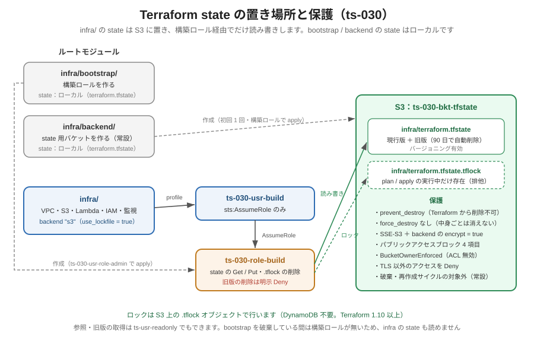

<!-- Last updated: 2026-10-28 10:50:00（公開版向けに、公開版に含めない実行ログへのリンクを外す） -->
# Terraform state の仕組み（S3 バックエンド）

本システムの Terraform state（状態ファイル）を、どこに・どのように保管し、どう守り、どう復旧するかをまとめた設計文書です。

関連資料：[運用ユーザーと再作成手順.md](運用ユーザーと再作成手順.md)（第4章 state の置き場所・第5章 破棄手順）／[provider_parameter.md](provider_parameter.md)（`backend "s3"` のキー）／[S3_parameter.md](S3_parameter.md)（state 用バケットの引数）／[IAM最小権限の仕組み.md](IAM最小権限の仕組み.md)（構築ロール）

---

## 1. state とは

state は、Terraform の設定（`.tf`）と AWS 上の実リソースの**対応表**です。Terraform は plan / apply のたびに state を読み、「どのリソースを自分が管理しているか」「前回からどこが変わったか」を判断します。

- state が無いと、Terraform は既存のリソースを自分のものと認識できません。そのまま apply すると、名前の重複が許されるリソース（VPC・サブネット・SG など）は二重に作成され、S3・IAM などは AlreadyExists で失敗します。本システムでも、端末の故障で state を失い、import で復旧した事例があります（[不具合一覧.md](不具合一覧.md) BUG-003）。
- state にはリソースの ID や属性がそのまま入り、機微な値を含むことがあります。そのため `*.tfstate` は `.gitignore` で Git の管理から外しています。

---

## 2. 要件と設計判断

### 要件

| # | 要件 |
|:-:|------|
| R1 | 作業端末が故障しても state が失われないこと |
| R2 | 同時に 2 つの plan / apply が走って state を壊さないこと（排他） |
| R3 | 誤った apply で state を壊しても、以前の版に戻せること |
| R4 | state の保管場所そのものを誤って削除できないこと |
| R5 | 保存時・通信時ともに暗号化されていること |
| R6 | 読み書きできる主体を最小にすること（管理者を常用しない） |

### 検討した案

| 案 | 内容 | 評価 |
|----|------|------|
| 案1 | ローカルに置き、手動でバックアップする | R1・R3 が運用頼みになり、実際に消失した事例があるため不採用 |
| 案2 | S3 に置き、ロックは DynamoDB テーブルで行う | 要件は満たすが、ロック専用のテーブルと権限が増えるため不採用 |
| **案3** | **S3 に置き、ロックは S3 上のロックファイル（`use_lockfile`）で行う** | **採用**。Terraform 1.10 以上の機能で、バケット 1 つで R1〜R6 を満たせる |
| 案4 | HCP Terraform（旧 Terraform Cloud）に置く | 外部サービスのアカウント管理が増え、AWS の中で完結しないため不採用 |

---

## 3. 全体構成



本システムは 3 つのルートモジュールに分かれ、state の置き場所が異なります。

| ルートモジュール | 作るもの | state の置き場所 | 破棄・再作成サイクル |
|------------------|----------|------------------|----------------------|
| `infra/` | VPC・S3・Lambda・IAM・監視など本体 | **S3**：`ts-030-bkt-tfstate` の `infra/terraform.tfstate` | 対象 |
| `infra/bootstrap/` | 構築ロール `ts-030-role-build` | ローカル：`infra/bootstrap/terraform.tfstate` | 対象 |
| `infra/backend/` | state 用バケット `ts-030-bkt-tfstate` | ローカル：`infra/backend/terraform.tfstate` | **対象外（常設）** |

bootstrap と backend の state をローカルに置く理由は次のとおりです。

- **backend**：state 用バケットを作るモジュール自身の state を、そのバケットに置くことはできません（作る前には置き場所が無いため）。
- **bootstrap**：構築ロールが無いと S3 の state を読み書きできないため、構築ロールを作るモジュールの state を S3 に置くと、構築ロールを作り直すときに読めなくなります。
- どちらもリソースが少なく（bootstrap 2 個、backend 7 個）、消失しても `terraform import` で短時間に復旧できます。

---

## 4. state 用バケットの設計（`infra/backend/state_bucket.tf`）

| 設定 | 値 | 満たす要件・目的 |
|------|----|------------------|
| バケット名 | `ts-030-bkt-tfstate` | — |
| `lifecycle { prevent_destroy = true }` | 有効 | R4：Terraform からバケットを破棄する plan をエラーにします |
| `force_destroy` | 指定しない | R4：中身が残っている限り、バケットは削除されません |
| バージョニング | `Enabled` | R3：state の更新ごとに旧版が残ります |
| ライフサイクル | 旧版を 90 日で削除（`noncurrent_days = 90`） | R3 の保持期間と容量のつり合い。現行版は削除しません |
| 既定の暗号化 | SSE-S3（AES256）＋バケットキー | R5：保存時の暗号化 |
| パブリックアクセスブロック | 4 項目すべて有効 | 公開の防止 |
| 所有者制御 | BucketOwnerEnforced | ACL を無効にし、アクセス制御をポリシーに一本化します |
| バケットポリシー | `aws:SecureTransport = false` を Deny | R5：TLS 以外のアクセスを拒否します |

- このバケットは `infra/backend/` で初回に 1 回だけ作り、`infra` / `bootstrap` の破棄・再作成では削除しません。
- 2026-09-23 時点で、`infra/terraform.tfstate` には 2 つの版（現行版と、S3 へ移した直後の版）が保存されています。ロックファイルの版と削除マーカーも同じバケットに残ります。

---

## 5. backend の設定（`infra/provider.tf`）

```hcl
terraform {
  required_version = ">= 1.10" # backend "s3" の use_lockfile が 1.10 以上を要求

  backend "s3" {
    bucket       = "ts-030-bkt-tfstate"
    key          = "infra/terraform.tfstate"
    region       = "ap-northeast-1"
    profile      = "ts-030-usr-build"
    assume_role  = { role_arn = "arn:aws:iam::<アカウントID>:role/ts-030-role-build" }
    encrypt      = true
    use_lockfile = true
  }
}
```

| キー | 意味 |
|------|------|
| `bucket` / `key` / `region` | state を置く場所です |
| `profile` / `assume_role` | provider と同じく `ts-030-usr-build` を起点に構築ロールを引き受けて S3 にアクセスします（R6） |
| `encrypt` | state オブジェクトをサーバー側で暗号化して保存します（R5） |
| `use_lockfile` | S3 上のロックファイルで排他します（R2）。Terraform 1.10 以上が必要なため、`required_version` も `>= 1.10` にしています |

- **backend ブロックでは変数を使えません。** そのため、バケット名・プロファイル・ロール ARN を直書きしています。
- backend を追加・変更したときは `terraform init -migrate-state` が必要です。本システムでは 2026-09-22 に、ローカルの state を `terraform init -migrate-state -force-copy` で S3 に移しました（`run-terraform.log`（公開版には含めていません））。

---

## 6. ロックの仕組み（`use_lockfile`）

1. plan / apply を始めると、Terraform は `infra/terraform.tfstate.tflock` を S3 に作成します。
2. 実行中に別の plan / apply が始まると、ロックファイルがあるため `Error acquiring the state lock` で止まります。
3. 処理が終わると、Terraform はロックファイルを削除します。

2026-09-22 に、plan の実行中に `.tflock` が存在し、終了後に消えることを実機で確認しました。

異常終了などでロックファイルが残った場合は、ほかに実行中の処理が無いことを確かめてから、エラーに表示される ID で解除します。

```bash
cd infra
terraform force-unlock <LOCK_ID>
```

---

## 7. 認証と権限

state へのアクセスも、provider と同じく**構築ロール経由**です。

```
ts-030-usr-build（sts:AssumeRole のみ）
   │ AssumeRole
   ▼
ts-030-role-build（infra/bootstrap/iam_build_role.tf）
   │ S3TerraformState / S3EmptyProjectBuckets / S3Management
   ▼
ts-030-bkt-tfstate
```

構築ロールのうち、state に関係する権限は次のとおりです。

| Sid | 効果 | 対象 | 用途 |
|-----|------|------|------|
| `S3TerraformState` | Allow `s3:GetObject`・`s3:PutObject` | `ts-030-bkt-tfstate/*` | state の読み書き、ロックファイルの作成 |
| `S3EmptyProjectBuckets` | Allow `s3:DeleteObject` | `ts-030-*/*` | ロックファイルの削除 |
| `S3Management` | Allow `s3:ListBucket` ほか | `*` | バケットの一覧・設定の読み取り |
| `DenyStateHistoryDeletion` | **Deny** `s3:DeleteObjectVersion` | `ts-030-bkt-tfstate/*` | state の旧版を消させない（明示的な Deny は Allow より優先します） |

- **bootstrap を破棄している間は構築ロールが無いため、`infra` の state も読めません。** 作成は bootstrap → infra、破棄は infra → bootstrap の順です。
- 参照用の `ts-usr-readonly` も、state バケットの一覧と旧版の取得ができます（IAM ポリシーシミュレーターで `s3:ListBucketVersions`・`s3:GetObjectVersion` が allowed であることを確認しました）。一方、構築ロールには `s3:GetObjectVersion` が無く、旧版は取得できません。
- **注意**：state には機微な値が含まれることがあります。`ts-usr-readonly` で state を読めることは、参照用ユーザーの権限として妥当かを今後確認する余地があります。

---

## 8. 運用と復旧の手順

### 8-1. 旧版の一覧を見る

```bash
aws s3api list-object-versions --profile ts-usr-readonly \
  --bucket ts-030-bkt-tfstate --prefix infra/terraform.tfstate \
  --query 'Versions[?Key==`infra/terraform.tfstate`].[VersionId,IsLatest,LastModified,Size]' \
  --output table
```

`--prefix` だけではロックファイル（`infra/terraform.tfstate.tflock`）の版も一緒に表示されるため、`Key` で絞り込んでいます。

### 8-2. 誤った apply の後、以前の版に戻す

state だけを戻しても実リソースは戻りません。戻した後の plan で、実リソースとの差分を必ず確認してください。

```bash
cd infra
# ① 現在の state を控える（ファイル名は *.tfstate にして Git の管理外にする）
terraform state pull > before-restore.tfstate

# ② 戻したい版を取得する（旧版の取得は ts-usr-readonly で行う）
aws s3api get-object --profile ts-usr-readonly \
  --bucket ts-030-bkt-tfstate --key infra/terraform.tfstate \
  --version-id <VersionId> restore.tfstate

# ③ 構築ロール経由で state を置き換える
#    旧版は serial（更新番号）が現在より小さいため、-force が必要になる場合がある
terraform state push restore.tfstate

# ④ 差分を確認する
terraform plan
```

作業後は、手元の `before-restore.tfstate` / `restore.tfstate` を不要になった時点で削除してください（機微な値を含むため）。

### 8-3. ロックが残った

第6章のとおり、`terraform force-unlock <LOCK_ID>` で解除します。

### 8-4. ローカルの state（bootstrap / backend）を失った

既存のリソースを import で取り込み直します。bootstrap の場合は次のとおりです（詳細は [運用ユーザーと再作成手順.md](運用ユーザーと再作成手順.md) 第5章、[不具合一覧.md](不具合一覧.md) BUG-003）。

```bash
cd infra/bootstrap
terraform init
terraform import aws_iam_role.build ts-030-role-build
terraform import aws_iam_role_policy.build ts-030-role-build:ts-030-role-build-policy
terraform plan   # No changes を確認
```

backend も同様に、バケットと付随設定（バージョニング・暗号化・PAB・所有者制御・ライフサイクル・ポリシーの 7 リソース）をバケット名で import します。

### 8-5. 別の端末から作業する

`infra/` の state は S3 にあるため、端末を替えても `terraform init` だけで同じ state を使えます。bootstrap と backend の state はローカルにあるため、端末を替えた場合は 8-4 の import で取り込みます。

---

## 9. まとめ

- `infra/` の state は、S3（`ts-030-bkt-tfstate`）に置き、`use_lockfile` のロックファイルで排他します。
- state 用バケットは、`prevent_destroy`・バージョニング（旧版 90 日）・暗号化・TLS 強制で守り、破棄・再作成の対象外にしています。
- state へのアクセスは構築ロール経由に限り、旧版の削除は明示的に拒否しています。
- bootstrap と backend の state は、置き場所の都合とリソース数の少なさからローカルに置き、失った場合は import で復旧します。
