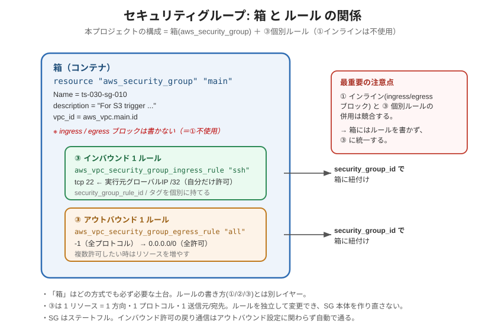

# セキュリティグループ 設定可能キー（Argument Reference）
<!-- Last updated: 2026-09-22 18:03:18（本システムの設計理由を追記し、設定例のコメントをコードに合わせ、文体を統一） -->

Terraform AWS Provider の公式ドキュメント（最新版）に基づく、セキュリティグループ関連リソースで設定可能なキー（引数）の一覧です。

本プロジェクトでは、SG 本体と個別ルールを**別リソース**で管理します（WBS 2.2）。

- `aws_security_group` … SG 本体（コンテナ）
- `aws_vpc_security_group_ingress_rule` … インバウンド 1 ルール
- `aws_vpc_security_group_egress_rule` … アウトバウンド 1 ルール

> 注記: 本一覧は **AWS Provider 最新版**の Argument Reference に基づいています（本プロジェクトは固定 `~> 5.0`、実バージョン `5.100.0`。設定例の `data "http"` は hashicorp/http の固定 `~> 3.0`、実バージョン `3.6.0`）。`required_providers` で固定しているプロバイダーバージョンによって、引数の有無や挙動に差異が出る可能性があります。

---

## 0. なぜ本体とルールを分けるのか（設計方針）

`aws_security_group` にはインライン `ingress` / `egress` ブロックを直接書く方式もありますが、**インライン方式と個別ルールリソース（`aws_vpc_security_group_*_rule`）の併用は競合**します（片方がもう片方のルールを削除しにいく）。本プロジェクトは、ルール変更時に SG 本体を作り直さずに済み差分が追いやすい**個別ルールリソース方式**に統一しています。

そのため `aws_security_group` 側の `ingress` / `egress` は**書かず**、SG 本体は「箱」だけを定義します。

### 箱とルールの関係（図）



- **箱（`aws_security_group`）**: `name` / `vpc_id` / `description` を持つコンテナです。どの方式でも必ず必要な土台で、ルールの書き方とは別レイヤーです。本プロジェクトでは `ingress` / `egress` ブロックを書きません（＝①インライン不使用）。
- **③ 個別ルール（`aws_vpc_security_group_*_rule`）**: `security_group_id` で箱に紐付きます。1 リソース = 1 方向・1 プロトコル・1 送信元/宛先です。各ルールが `security_group_rule_id` とタグを個別に持てます。
- **併用不可**: 「① インライン」と「③ 個別ルール」を同じ SG に混在させると競合するため、③ に統一します。「箱 ＋ ③」は矛盾しません（箱は①ではありません）。

---

## 1. `aws_security_group`（SG 本体）

### 1-1. トップレベルの引数

| キー | 必須/任意 | 説明 |
|---|---|---|
| `name` | 任意 | SG 名。指定しない場合は Terraform が一意名を生成します。`name_prefix` と同時指定は不可。同一 VPC 内で重複不可。 |
| `name_prefix` | 任意 | `name` の代わりにプレフィックスを与え、末尾にランダム文字列を付けた名前を生成します。 |
| `description` | 任意 | SG の説明。既定値は `Managed by Terraform`。**作成後は変更不可**（変更すると再作成）。 |
| `vpc_id` | 任意（実質必須） | SG を作成する VPC の ID。省略すると default VPC が対象になるため、明示するのが安全。 |
| `ingress` | 任意 | インバウンドルールのインラインブロック。**本プロジェクトでは使用しません**（個別ルールリソースを使うため）。 |
| `egress` | 任意 | アウトバウンドルールのインラインブロック。**本プロジェクトでは使用しません**。 |
| `revoke_rules_on_delete` | 任意 | 削除前に全ルールを失効させるか。相互参照する SG の削除デッドロック回避に使います。既定 `false`。 |
| `region` | 任意 | このリソースを管理するリージョン。省略時は provider 設定のリージョン。 |
| `tags` | 任意 | 付与するタグのマップ。`default_tags` と同キーは上書き。 |

### 1-2. Attribute（参照のみ・設定不可）

| Attribute | 説明 |
|---|---|
| `id` | SG の ID（例: `sg-0123456789abcdef1`）。ルールや EC2 から参照します。 |
| `arn` | SG の ARN。 |
| `owner_id` | SG を所有する AWS アカウントの ID。 |
| `tags_all` | `default_tags` を含む全タグのマップ。 |

---

## 2. `aws_vpc_security_group_ingress_rule`（インバウンド 1 ルール）

1 リソース = **1 方向・1 プロトコル・1 宛先/送信元**のルールを表します。複数許可したい場合はリソースを複数定義します。

| キー | 必須/任意 | 説明 |
|---|---|---|
| `security_group_id` | **必須** | ルールを追加する対象の SG の ID。 |
| `ip_protocol` | **必須** | プロトコル。`tcp` / `udp` / `icmp` / `icmpv6` または番号。`-1`（全プロトコル）指定時はポート指定不可。 |
| `from_port` | 条件付き | 開始ポート（`icmp` の type 兼用）。`ip_protocol` が `-1` 以外で必要。 |
| `to_port` | 条件付き | 終了ポート（`icmp` の code 兼用）。単一ポートは from と同値にします（例: SSH は 22/22）。 |
| `cidr_ipv4` | 送信元のいずれか1つ | 許可する送信元 IPv4 CIDR（例: `203.0.113.10/32`）。 |
| `cidr_ipv6` | 送信元のいずれか1つ | 許可する送信元 IPv6 CIDR。 |
| `prefix_list_id` | 送信元のいずれか1つ | 送信元をマネージドプレフィックスリストで指定。 |
| `referenced_security_group_id` | 送信元のいずれか1つ | 送信元を別の SG（または自 SG）で指定。SG 間参照に使います。 |
| `description` | 任意 | ルールの説明。 |
| `tags` | 任意 | ルールに付与するタグ。ルールにも Name 等を付けられます。 |

> 送信元（`cidr_ipv4` / `cidr_ipv6` / `prefix_list_id` / `referenced_security_group_id`）は**いずれか 1 つ**を指定します。

### Attribute（参照のみ）

| Attribute | 説明 |
|---|---|
| `security_group_rule_id` | 個別ルールの ID（例: `sgr-08c2b34114edf15e1`）。 |
| `arn` | ルールの ARN。 |
| `tags_all` | `default_tags` を含む全タグ。 |

---

## 3. `aws_vpc_security_group_egress_rule`（アウトバウンド 1 ルール）

引数は `aws_vpc_security_group_ingress_rule` と同一構成です（送信元ではなく**宛先**を表す点が意味的な違い）。全許可は次の指定になります。

| キー | 値（全許可の例） | 説明 |
|---|---|---|
| `security_group_id` | `aws_security_group.main.id` | 対象 SG。 |
| `ip_protocol` | `-1` | 全プロトコル。ポート指定は不可。 |
| `cidr_ipv4` | `0.0.0.0/0` | 全宛先。 |

---

## 4. 重要な注意点

- **インライン `ingress`/`egress` と個別ルールの併用不可**: 本プロジェクトは個別ルールリソースに統一しています。`aws_security_group` 側にはルールを書きません。
- **SG はステートフル**: インバウンドで許可した通信の戻りパケットは、アウトバウンド設定に関わらず自動で通ります。アウトバウンド制限は「EC2 が能動的に外へ出る通信」のみを縛ります。
- **`description` は変更で再作成**: SG 本体・ルールともに `description` は更新時に置き換えになります。
- **全許可の `-1` はポート指定不可**: `ip_protocol = "-1"` のときに `from_port`/`to_port` を書くとエラーになります。
- **ルール単体では機能しない**: ルールは SG 本体に紐付き、その SG が EC2 等の ENI にアタッチされて初めて有効になります。

---

## 5. 本システムの SG 設計と理由

`infra/security.tf` では、EC2（`ts-030-ec2-010`）用の SG を次の方針で定義しています。

| 方向 | 許可内容 | 理由 |
|---|---|---|
| インバウンド | SSH（TCP 22）を、`terraform apply` の実行元グローバル IP `/32` のみ許可 | EC2 はバッチ実行用で、外部から接続を受けるサービスを持ちません。調査用の SSH だけを、構築した端末の IP に限定して開けています。 |
| アウトバウンド | 全プロトコル・全宛先（`0.0.0.0/0`）を許可 | EC2 は S3（入力取得・結果出力）、SNS・SES（通知）、CloudWatch Logs などへ能動的に接続します。宛先が AWS の各サービスエンドポイントにまたがるため、送信側は絞っていません。 |

- **実行元 IP の動的取得**: `data "http"` で `https://checkip.amazonaws.com` にアクセスし、返ってきた本文（末尾の改行を `chomp` で除去）に `/32` を付けて `cidr_ipv4` にします。IP は AWS 側ではなく、`terraform plan/apply` を実行したマシンから取得されます。
- **IP が変わった場合**: 実行元のグローバル IP が変わると、次の `plan` でインバウンドルールの差分として表示されます。`apply` すると、SG 本体は作り直さずルールだけが置き換わります（個別ルールリソース方式の利点です）。
- **戻り通信**: SG はステートフルなため、アウトバウンドで開始した通信の応答はインバウンドルールが無くても受信できます。

---

## 6. 設定例（参考）

本プロジェクトの `infra/security.tf` の構成です。見出しコメントは区切り線を省略し、行末のコメントは説明用に付け加えたものです。

```hcl
# 実行元グローバル IP の取得
data "http" "myip" {
  url = "https://checkip.amazonaws.com"           # 説明用: 送信元 IP を平文で返す
}

# セキュリティグループ本体
resource "aws_security_group" "main" {
  name        = "${var.prj_prefix}-sg-010"
  description = "For S3 trigger type shell script auto execution system"
  vpc_id      = aws_vpc.main.id                    # 説明用: 作成済み VPC を参照

  tags = {
    Name = "${var.prj_prefix}-sg-010"
  }
}

# インバウンド: SSH(TCP 22) を実行元グローバル IP /32 のみ許可
resource "aws_vpc_security_group_ingress_rule" "ssh" {
  security_group_id = aws_security_group.main.id
  cidr_ipv4         = "${chomp(data.http.myip.response_body)}/32"  # 説明用: 末尾改行を除去
  ip_protocol       = "tcp"
  from_port         = 22
  to_port           = 22

  tags = {
    Name = "${var.prj_prefix}-sgr-ssh-010"
  }
}

# アウトバウンド: 全許可（SG 既定の全許可ルールを明示的に定義）
resource "aws_vpc_security_group_egress_rule" "all" {
  security_group_id = aws_security_group.main.id
  cidr_ipv4         = "0.0.0.0/0"
  ip_protocol       = "-1" # 全プロトコル

  tags = {
    Name = "${var.prj_prefix}-sgr-egress-010"
  }
}
```
