<!-- Last updated: 2026-09-22 18:05:04（です・ます調に統一し、画面の注記を追加） -->
# ts-030-usr-buildユーザーの作成

コンソールで運用ユーザーを作成する画面例です（2026-07-08 取得）。手順の全体と3ユーザー共通の説明は [運用ユーザーと再作成手順.md](運用ユーザーと再作成手順.md) の第2章を参照してください。

> **注意**：以下の画面は、同じ手順で **`ts-030-usr-role-admin`**（ポリシー `ts-030-policy-role-admin`、説明「for bootstrap」、JSON は運用ユーザーと再作成手順.md の §2-1）を作成したときのものです（画像で確認、2026-09-22）。`ts-030-usr-build` を作成する場合は、ユーザー名・ポリシー名・JSON を次のとおり読み替えてください。最後のユーザー一覧の画面には、当時の旧ユーザー（`ts-usr-assume-role` 等）も写っています。

`ts-030-usr-build` の場合、ポリシー名は `ts-030-policy-build`（カスタマー管理ポリシー）で、エディタに貼り付ける JSON は次のとおりです（構築ロールの AssumeRole のみ）。

```json
{
  "Version": "2012-10-17",
  "Statement": [
    {
      "Sid": "AssumeBuildRole",
      "Effect": "Allow",
      "Action": "sts:AssumeRole",
      "Resource": "arn:aws:iam::123456789012:role/ts-030-role-build"
    }
  ]
}
```

## ポリシー作成

> 以降の画面はすべて 2026-07-08 時点のもので、`ts-030-usr-role-admin` を作成したときの画面です。

- 左ペインでポリシーを選択し、ポリシーの作成をクリックします。

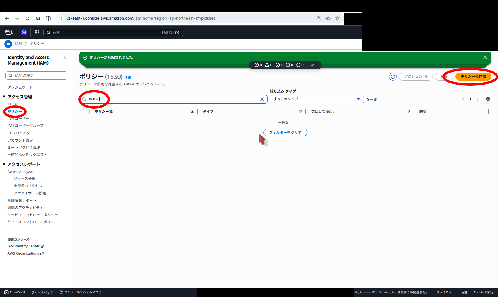

- JSON をクリックします。

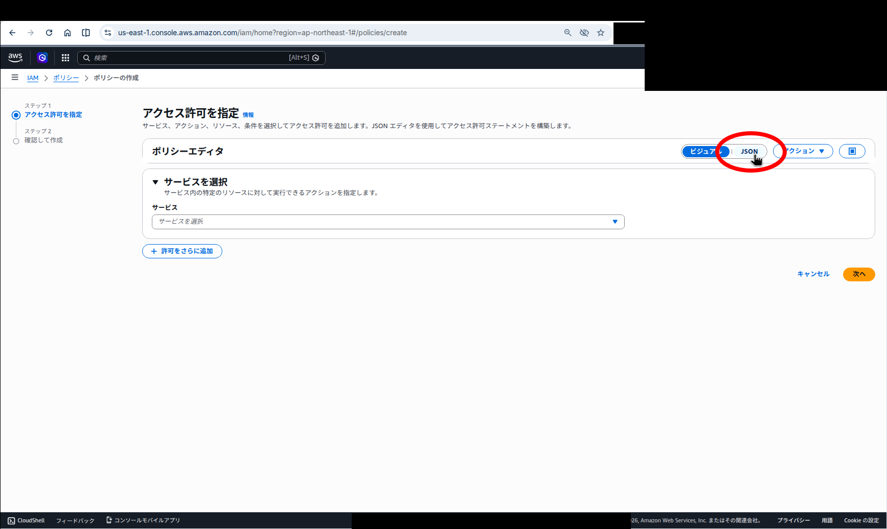

- ポリシーエディタで、ポリシーを書き換えます。

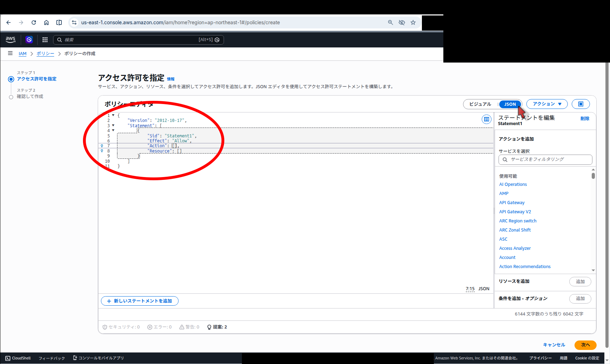

- 書き換えた状態です。

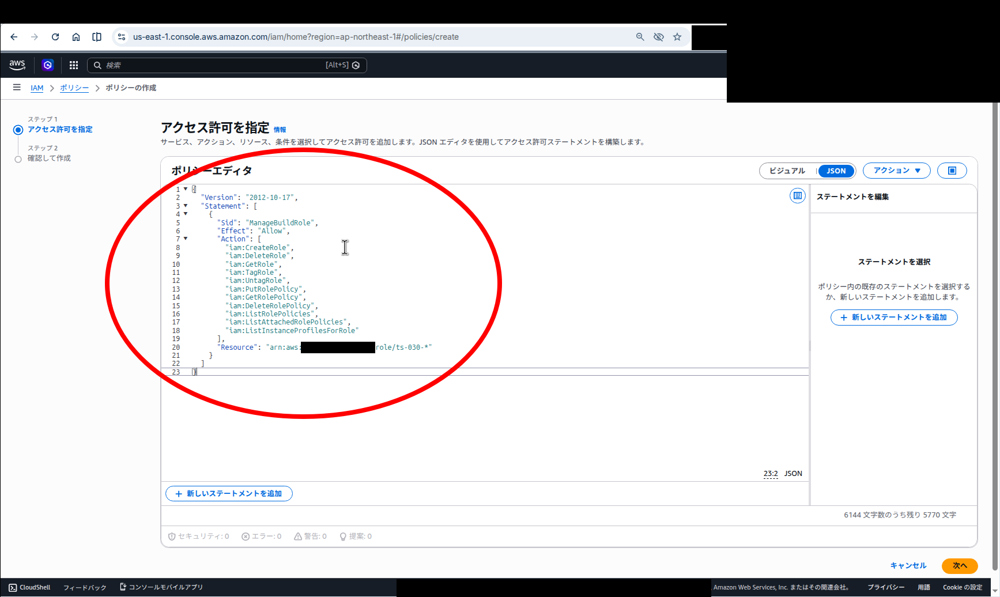

- ポリシー名と説明を入力し、次へをクリックします。

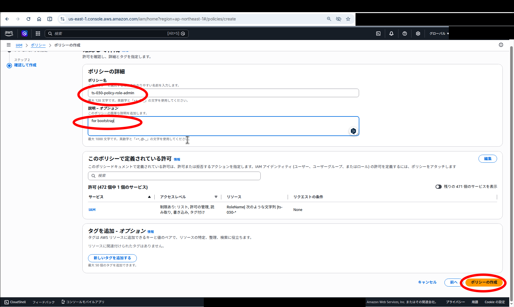

※ 2026-07-08 時点の画面です。`ts-030-usr-role-admin` 作成時のもので、ユーザー名・ポリシー名は読み替えてください。

## ユーザーの作成

- 左ペインで IAM ユーザーをクリックし、ユーザーの作成をクリックします。

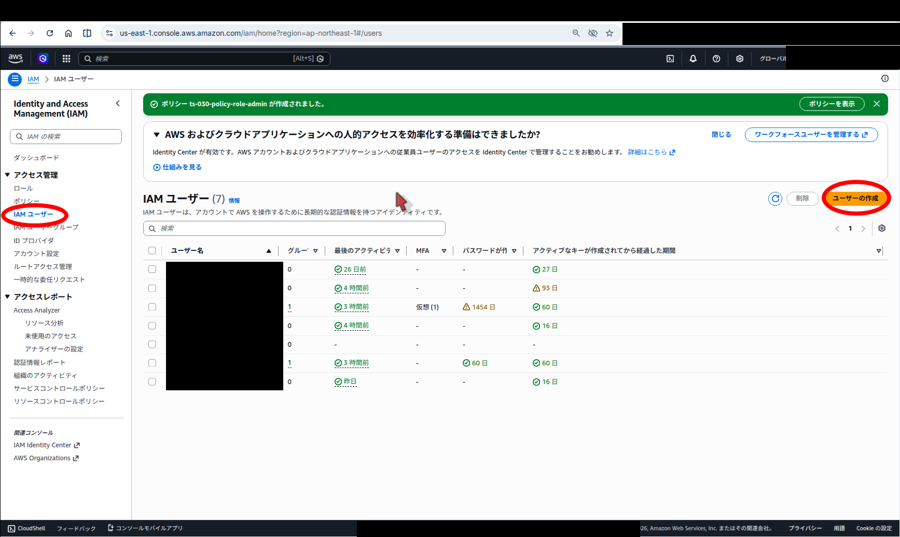

- ユーザーの名前を入力し、次へをクリックします。

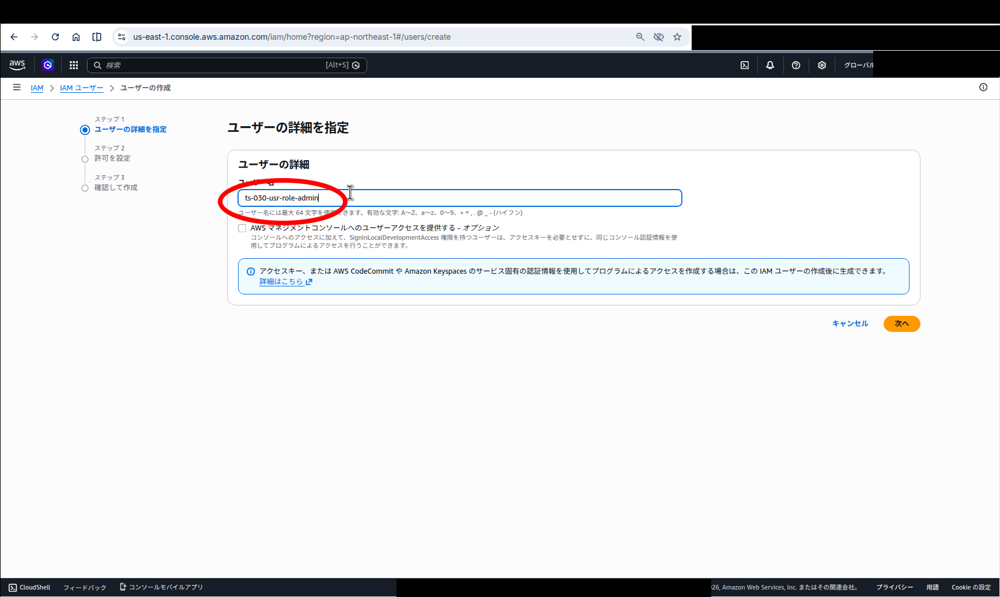

※ 2026-07-08 時点の画面です。`ts-030-usr-role-admin` 作成時のもので、ユーザー名・ポリシー名は読み替えてください。

- 「ポリシーを直接アタッチする」をクリックします。

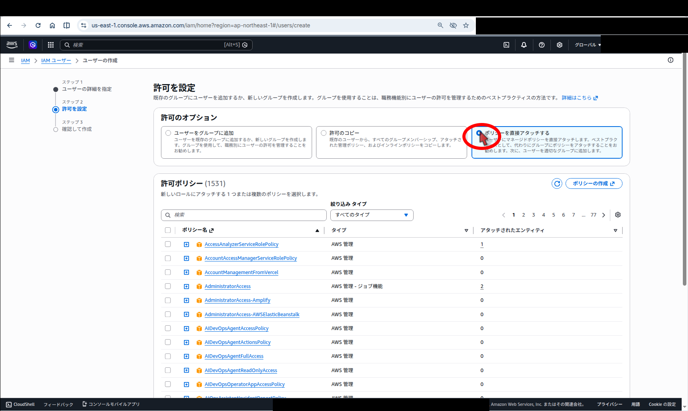

- ポリシーを選択し、次へをクリックします。

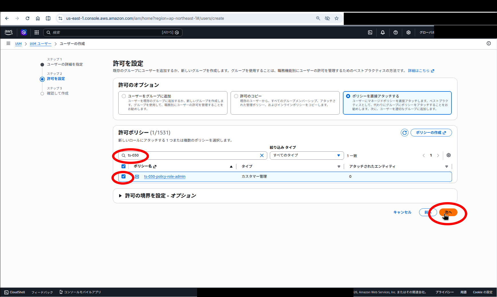

※ 2026-07-08 時点の画面です。`ts-030-usr-role-admin` 作成時のもので、ユーザー名・ポリシー名は読み替えてください。

- ユーザーの作成をクリックします。

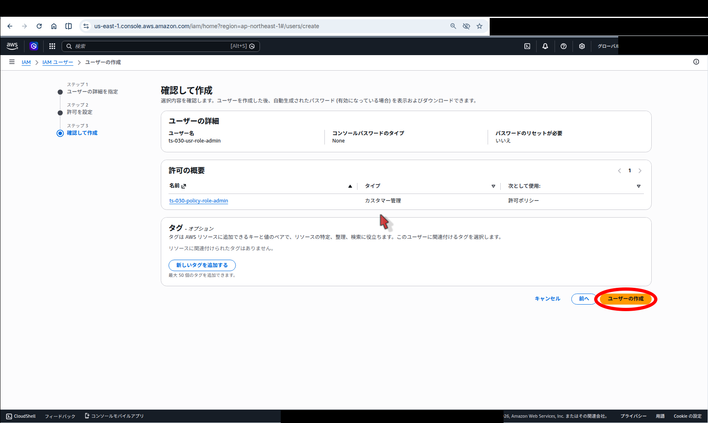

※ 2026-07-08 時点の画面です。`ts-030-usr-role-admin` 作成時のもので、ユーザー名・ポリシー名は読み替えてください。

- ユーザーが作成されます。

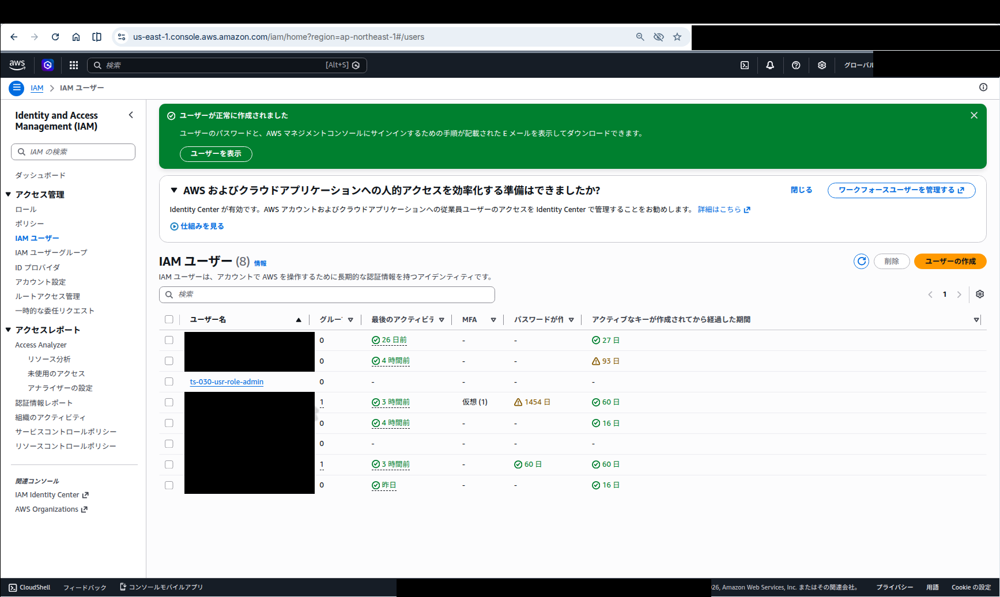

※ 2026-07-08 時点の画面です。当時のユーザー名（`ts-usr-assume-role` など、現在は存在しないユーザー）が写っています。
