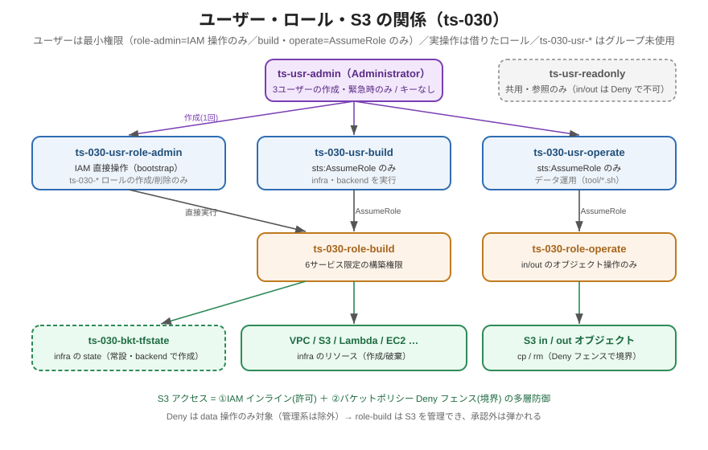

<!-- Last updated: 2026-09-22 18:03:58（です・ます調に統一） -->
# ユーザーとロール一覧（ts-030）

本プロジェクトの IAM ユーザー・ロールの確定モデルと、S3 データアクセスの設計をまとめます。
`ts-030-usr-*` に **IAM グループは未使用**です（用途別のユーザー＋AssumeRole で権限を分離するため）。共用ユーザー `ts-usr-*` はアカウント共通のグループ（`ts-grp-admin` / `ts-grp-readonly`）に所属します。

関連：[運用ユーザーと再作成手順.md](運用ユーザーと再作成手順.md)（作成手順）／[IAM最小権限の仕組み.md](IAM最小権限の仕組み.md)／[AssumeRoleまとめ.md](AssumeRoleまとめ.md)

---

## 1. IAM ユーザー（5）

| ユーザー | プレフィックス | アクセスキー | 用途 | 引き受けるロール | 作成 |
|----------|:---:|:---:|------|-------------------|------|
| `ts-usr-admin` | なし＝アカウント全体の管理者 | 持たせない（コンソール専用。2026-09-22 時点でキー無し） | `ts-030-usr-*` の作成・緊急時のみ | — | ルート/手動 |
| `ts-usr-readonly` | なし＝共用の参照専用 | 持つ | 実機確認（参照のみ。`terraform plan` は不可。in/out バケットの中身は Deny フェンスで参照不可。`tool/get-now.sh` 等の EC2・ログ参照に使用） | — | 既存の共用ユーザー（`ts-grp-readonly`） |
| `ts-030-usr-role-admin` | ts-030 | 持つ | bootstrap を Terraform 実行 | —（IAM 直接操作） | `ts-usr-admin` がコンソール作成 |
| `ts-030-usr-build` | ts-030 | 持つ | infra・infra/backend を Terraform 実行 | `ts-030-role-build` | 同上 |
| `ts-030-usr-operate` | ts-030 | 持つ | `tool/upl-run.sh`・`pop-s3.sh`・`del-s3.sh`・`get-now.sh` で in/out データ操作（`~/.aws/config` の `ts-030-role-operate` プロファイル経由で AssumeRole） | `ts-030-role-operate` | 同上 |

- プロジェクト固有ユーザーには `ts-030-` を付けます（規約）。`ts-usr-*`（admin / readonly）はプロジェクト非依存の共用ユーザーのため例外です。
- `ts-030-usr-*` のポリシーはカスタマー管理ポリシー（`ts-030-policy-role-admin` / `ts-030-policy-build` / `ts-030-policy-operate`）を直接アタッチしています。
- ユーザー自身の権限は最小（role-admin=IAM 操作のみ／build・operate=`sts:AssumeRole` のみ）。実操作の権限は借りたロールが持ちます。

## 2. IAM ロール（4）

| ロール | 用途 | Assume する主体 | 信頼ポリシー | 主要権限 | 定義場所 |
|--------|------|-----------------|--------------|----------|----------|
| `ts-030-role-build` | インフラ構築 | `ts-030-usr-build` | アカウントルート信頼 | 6サービス限定（IAM/EC2（VPC 含む）/S3/Lambda/Logs/CloudTrail）＋STS（GetCallerIdentity）。S3 のオブジェクト操作だけ ARN 限定：state バケット `ts-030-bkt-tfstate/*` の Get/Put、`ts-030-*/*` の DeleteObject、state 旧世代の削除（DeleteObjectVersion）は明示 Deny | `infra/bootstrap/iam_build_role.tf` |
| `ts-030-role-operate` | データ運用 | `ts-030-usr-operate` | **`ts-030-usr-operate` の ARN を直接信頼** | in=Put/Get/Delete/List、out=Get/Delete/List | `infra/iam.tf` |
| `ts-030-role-lambda-010` | Lambda 実行 | `lambda.amazonaws.com` | サービス信頼 | in GetObject / EC2 起動（RunInstances 等＋`iam:GetInstanceProfile`）/ EC2 削除（`autogen-by` タグ付きのみ。起動待ちタイムアウト時）/ PassRole（ec2-010）/ SNS / SES ＋ AWSLambdaBasicExecutionRole（ログは `/aws/lambda/ts-030-lmd-010`） | `infra/iam.tf` |
| `ts-030-role-ec2-010` | EC2 実行 | `ec2.amazonaws.com` | サービス信頼 | in Get+List / out Put / SNS / SES / logs（`ts-030-log-*`）＋ CloudWatchAgentServerPolicy | `infra/iam.tf` |

- 対の対応は `usr-build` ↔ `role-build`、`usr-operate` ↔ `role-operate` です。
- `role-lambda-010` / `role-ec2-010` は「サービス（Lambda/EC2）が引き受ける実行ロール」です。人（ユーザー）は引き受けません。

## 3. S3 データアクセス設計（in / out）

アクセス制御を**2レイヤーの役割分担**で構成します（真の多層防御）。

| 層 | 種別 | 役割 | 実体 |
|----|------|------|------|
| ① IAM インライン | IDベース | **許可(grant)** | 各ロールに必要な data 操作を付与（`infra/iam.tf`） |
| ② バケットポリシー | リソースベース | **境界(fence, Deny)** | 承認 principal 以外の data 操作を Deny（`infra/storage.tf`） |

### バケットごとの権限（誰が何をするか）

| 主体 | in | out |
|------|----|----|
| `role-lambda-010` | `GetObject`（.conf 読取） | —（書かない） |
| `role-ec2-010` | `GetObject`＋`ListBucket`（入力の再帰取得） | `PutObject`（結果・ログ書込） |
| `role-operate` | `Put/Get/Delete`＋`ListBucket`（運用） | `Get/Delete`＋`ListBucket`（運用） |
| `ts-usr-admin` | 緊急（Deny フェンスの除外に含む） | 同左 |
| `ts-usr-readonly` | 不可（Deny フェンス） | 不可（Deny フェンス） |

### Deny フェンスの要点

- `Effect:"Deny"` ＋ `Principal:"*"` ＋ `Condition StringNotLike aws:PrincipalArn [承認ARN群]` で、**承認外の data 操作を拒否**します。
  - `NotPrincipal+Deny` はロールのセッション ARN を取りこぼすため使いません。`aws:PrincipalArn` は assumed-role でもロール ARN に解決されるため確実です。
- **Deny 対象は data 操作のみです**（`GetObject`/`PutObject`/`DeleteObject`/`ListBucket`）。管理系（`PutBucketPolicy` 等）は対象外です。
- 承認 principal：**in** = lambda-010 / ec2-010 / operate / **build** / `ts-usr-admin` です。**out** = ec2-010 / operate / **build** / `ts-usr-admin`（Lambda は out に触れないため除外）です。
- **`ts-030-role-build`（Terraform 管理主体）は必ず承認に含めます**。Terraform は bucket の refresh 時に `HeadBucket` を呼び、これは `s3:ListBucket` 権限で評価されるため、フェンスで `ListBucket` を Deny すると refresh が 403 になり「バケット削除済み」と誤検知して再作成 plan を生みます。管理系のみを対象外にするだけでは不足で、build ロールの明示除外が必要です（2.4e 適用時に実際に発生し、修正済みです）。
- なぜ Allow のみでは駄目か：同一アカウントは OR 評価のため、Allow だけのバケットポリシーは「承認外を拒否」できず、実効的な制限になりません（IAM が万一過剰許可されても止められません）。Deny があって初めて防御層として機能します。

### state バケット（ts-030-bkt-tfstate）

`infra/` の state を置くバケットで、in/out とは設計が異なります。

- `infra/backend/` で作成する常設バケットです（`prevent_destroy`。破棄・再作成サイクルの対象外）。
- バケットポリシーは TLS 以外のアクセスを拒否する `DenyInsecureTransport` のみです。in/out のような承認 principal の Deny フェンスはありません。
- アクセスは構築ロールの `S3TerraformState`（`GetObject`/`PutObject`）で許可します。ロックファイル（`.tflock`）の削除は `S3EmptyProjectBuckets`（`DeleteObject`）で行います。state の旧世代の削除は `DenyStateHistoryDeletion` で拒否します。
- バージョニング有効・旧バージョンは 90 日で削除・SSE-S3・パブリックアクセスブロック全有効・BucketOwnerEnforced です。

