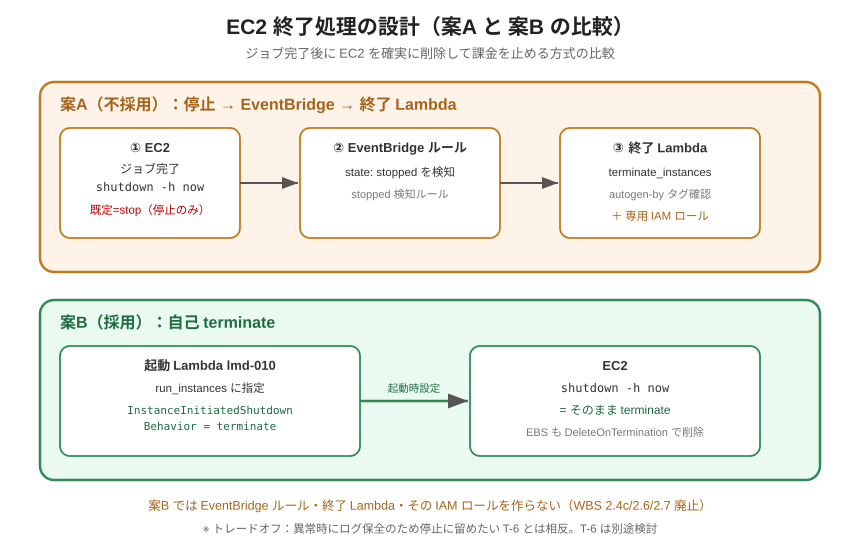
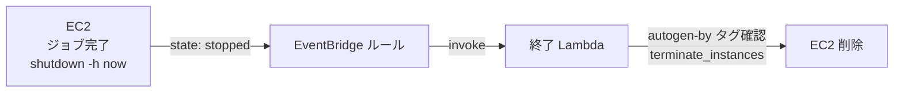
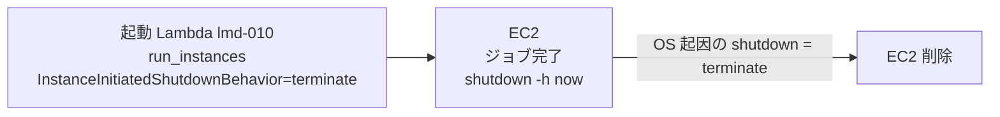

<!-- Last updated: 2026-09-22 17:17:37（新規設計としての設計判断文書「終了処理の設計」に書き換え） -->
# 終了処理の設計（WBS 2.4c）

## 1. 結論

ジョブ完了後の EC2 の削除は、**起動時に `InstanceInitiatedShutdownBehavior=terminate` を指定し、OS の shutdown をそのまま terminate にする方式（案B）** を採用しました。
起動 Lambda（`ts-030-lmd-010`）が `run_instances` にこのパラメータを指定するだけで、ジョブ完了後の `shutdown -h now`（`user_data_template.sh`）が **stop ではなく terminate** になります。

このため、本システムには次のリソースを作りません。

- 終了処理専用の Lambda とその IAM ロール
- EC2 の `stopped` を検知する EventBridge ルールと Lambda 呼び出し許可

## 2. 要件

- ジョブ（`run.sh`）完了後、EC2 を**確実に削除**して課金を止めます（stop のままでも EBS の課金は続くため、terminate まで行います）。
- ジョブ用の EBS もインスタンスとともに削除します。
- 本システムが起動した EC2 以外には影響を与えません。
- 構成要素と IAM 権限を最小にします。

## 3. 検討した案



※ 案A は比較のために描いたもので、本システムには存在しません。

### 案A（不採用）：停止 → EventBridge → 終了 Lambda



- EC2 の既定の shutdown 挙動は **stop** です。`shutdown -h now` では停止するだけで削除されません。
- そのため後段で EventBridge が `stopped` を検知し、終了 Lambda が `terminate_instances` を実行して削除します。
- 終了 Lambda は任意のインスタンスを terminate できる権限を持つため、`autogen-by: ts-030-system` タグを確認してシステム生成インスタンスだけを削除する誤終了ガードが必要です。
- 必要なリソースは、EventBridge ルール、終了 Lambda、その IAM ロールとポリシー、Lambda 呼び出し許可です。

### 案B（採用）：起動時 `InstanceInitiatedShutdownBehavior=terminate` による自己 terminate



- 起動時パラメータ 1 つで、`shutdown -h now` が **そのインスタンス自身を terminate** します。
- 自己終了は自インスタンスにしか作用しないため、誤終了ガードは不要です。なお `autogen-by`（値 `<prj_prefix>-system`）と `Project` タグは、識別・タグ検索のため EC2/EBS に付与しています（`lambda_function.py` の `TagSpecifications`）。

### 比較

| 観点 | 案A：停止 → EventBridge → 終了 Lambda | 案B：自己 terminate（採用） |
|------|--------------------|--------------------------|
| 構成の簡潔さ | Lambda + EventBridge + IAM が必要 | 起動パラメータ 1 つ |
| 追加の IAM 権限 | 終了 Lambda 用ロール（`ec2:TerminateInstances` 等） | 不要（`RunInstances` の一パラメータ） |
| 誤終了リスク | 終了 Lambda 側でタグガードが必要 | 自己終了のため他インスタンスに波及しない |
| 異常時のログ保全 | shutdown を抑止すれば stop で残せる余地がある | shutdown = 即 terminate で残せない |

案B は構成要素・権限・誤終了リスクのいずれでも有利なため採用しました（2026-07-08 決定）。異常時のログ保全で劣る点は、次節のトレードオフとして扱います。

## 4. 実装

`infra/lambda/lambda_function.py` の `instance_params`（`run_instances` 引数）に次の 1 行を指定しています（抜粋）。

```python
instance_params = {
    'ImageId': ...,
    'InstanceType': ...,
    # ...
    'MinCount': 1,
    'MaxCount': 1,
    # インスタンス自身の shutdown で terminate する。
    'InstanceInitiatedShutdownBehavior': 'terminate'
}
```

- **IAM 追加権限は不要**です。`InstanceInitiatedShutdownBehavior` は `RunInstances` の一パラメータであり、`lmd-010` のロールに追加の権限はありません。
- `user_data_template.sh` は通常どおり最後に `shutdown -h now` を実行するだけです。

### EBS の削除（DeleteOnTermination）

- run.conf に `ebs_size` または `ebs_type` があるときは、`lambda_function.py` が `DeleteOnTermination: True` を明示します。
- 無いときは AMI の既定値に従います。既定 AMI（`ami-09ed31f8f34719e20`、Amazon Linux 2）のルートボリュームも `DeleteOnTermination=True` です（2026-09-22 に describe-images で確認しました）。

### 動作確認

2026-09-22 の E2E（WBS 2.9）で、ジョブ完了後に EC2 が自己 terminate することを確認しました。この E2E は `ebs_size: 50` 指定ありで、EC2 の terminate とともに EBS が削除されたことも確認しました。

## 5. トレードオフ（改善対象 T-6 との関係）

改善対象 **T-6**（ffmpeg 異常終了時のログ消失対策）は、「エラー時は shutdown せず**停止**に留めて調査可能にする」案を含みます。
一方、案B は「shutdown したら**必ず terminate**」となるため、両者は相反します。

**方針**：まず案B を採用して構成を簡潔にします。T-6 のログ保全は別軸の課題として、
将来的に **user_data 側でエラー分岐（正常完了時のみ `shutdown`、異常時は shutdown せず残す）** や
**CloudWatch Logs へのリアルタイム転送**で対応します（フェーズ3以降で検討します。詳細は [改善対象.md](改善対象.md) の T-6）。

## 6. 関連文書

- [改善対象.md](改善対象.md)（T-3 / T-6）
- [用語一覧.md](用語一覧.md)（`InstanceInitiatedShutdownBehavior`）
- [WBS.md](WBS.md)（2.4c / 2.6 / 2.7 の廃止）
