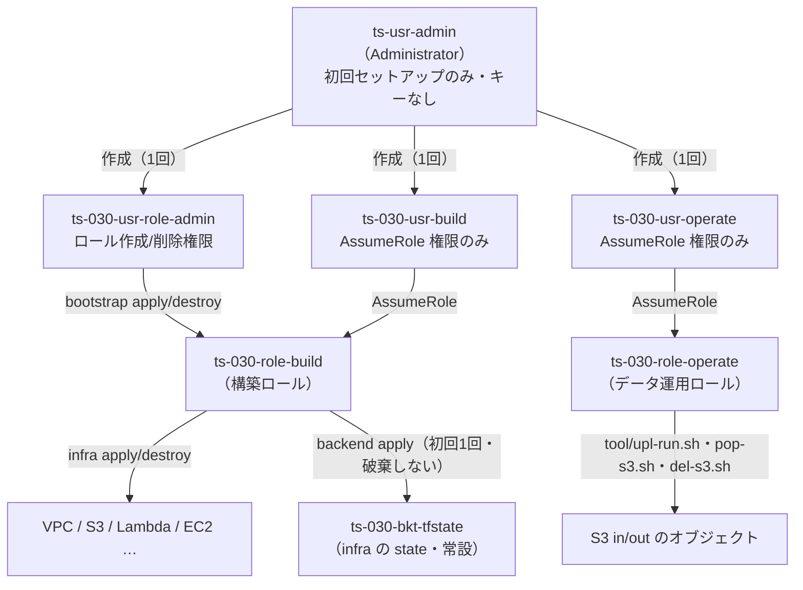

<!-- Last updated: 2026-09-23 01:12:24（state の仕組みの詳細文書へのリンクを追加） -->
# 運用ユーザーと破棄・再作成手順

インフラの構築・破棄・**データ運用**を **管理者（Administrator）を常用せずに** 回すための、IAM ユーザー構成と `terraform destroy` → `apply` の手順をまとめます。

関連資料：[ユーザーとロール一覧.md](ユーザーとロール一覧.md)（確定モデルの一覧・S3 データアクセス設計）／[IAM最小権限の仕組み.md](IAM最小権限の仕組み.md)（構築ロールと AssumeRole の仕組み）

> **命名について**：プロジェクト固有のユーザーは規約どおり `ts-030-` プレフィックスを付けます（`ts-030-usr-*`）。例外は `ts-usr-*` の**共用ユーザー**（`ts-usr-admin`＝アカウント全体の管理者、`ts-usr-readonly`＝参照専用）で、プロジェクト非依存のためプレフィックスを付けません。`ts-030-usr-*` は IAM **グループ未使用**です（共用ユーザーは `ts-grp-admin` / `ts-grp-readonly` グループに所属）。

---

## 1. 運用ユーザー構成

構築・破棄・運用のサイクルを、用途ごとに権限を絞った専用ユーザーで実行します。`ts-usr-admin` は**`ts-030-usr-*` の作成と緊急時のみ**に使い、日常運用では使いません（アクセスキーは持たせず、コンソール専用。2026-09-22 時点でキー無しを確認済み）。

| ユーザー | 用途 | ユーザー自身の権限（IDポリシー） | 引き受けるロール／実行 |
|----------|------|----------------------------------|------------------------|
| `ts-usr-admin` | `ts-030-usr-*` の作成・緊急時のみ | Administrator（`ts-grp-admin`。常用しない・キーなし） | — |
| `ts-usr-readonly` | 実機確認（参照のみ） | 参照系のみ（`ts-grp-readonly`） | 直接実行（`info-ts-030.sh`・`tool/aws-describe-tagged-resources.sh`・`tool/get-now.sh` 等の EC2・ログ参照）。`terraform plan` は不可。**in/out バケットの中身はバケットポリシーの Deny フェンスで参照不可** |
| `ts-030-usr-role-admin` | 構築ロールの作成/削除 | `ts-030-*` ロールの IAM 操作のみ（§2-1） | `infra/bootstrap/`（直接実行） |
| `ts-030-usr-build` | インフラの構築/破棄 | `sts:AssumeRole` のみ（§2-2） | `ts-030-role-build` を借りて `infra/`・`infra/backend/` を実行 |
| `ts-030-usr-operate` | in/out のデータ操作 | `sts:AssumeRole` のみ（§2-3） | CLI プロファイル `ts-030-role-operate` 経由で `tool/upl-run.sh` 等を実行（S3 in/out のみ。EC2・ログは参照不可） |

> 注：「用途」と「ユーザー自身の権限」は別物です。とくに `ts-030-usr-build` / `ts-030-usr-operate` は**自分自身では `sts:AssumeRole` しかできず**、実際の操作権限は**借りたロール側**が持ちます（[AssumeRoleまとめ.md](AssumeRoleまとめ.md)）。



### なぜユーザーを分けるのか

- **bootstrap（構築ロールの作成・削除）には IAM 作成権限が必要**で、`sts:AssumeRole` のみの `ts-030-usr-build` では実行できません。
- 逆に **infra（リソース作成）は構築ロールを引き受けて行う**ため、`ts-030-usr-build` で実行できます。
- **データ運用（in/out の投入・取得・削除）は構築権限を必要としない**ため、専用の `ts-030-usr-operate` に分離します。これにより、日常の運用作業を「全インフラを破棄できる credential」で行わずに済みます。
- 用途ごとに最小権限のユーザーを分けることで、どの認証情報が漏れても影響範囲を限定できます。

### 命名の考え方

方針は2つです。

1. **プロジェクト固有のユーザーは `ts-030-` プレフィックスを付けます**（ロールや他リソースと同じ規約）。IAM ユーザーもリソースであり、この3ユーザーは ts-030 のためだけに作るためです。例外は `ts-usr-*` の共用ユーザー（プロジェクト非依存）です。
2. **名前は「用途・ペルソナ」を表し、「権限の範囲」を名前に埋め込みません**（権限は名前ではなく IDポリシーで保証します）。

「ユーザー」と「そのユーザーが引き受けるロール」を**語で対応**させています。

| ユーザー | 引き受けるロール | ペルソナ |
|----------|------------------|----------|
| `ts-030-usr-build` | `ts-030-role-build` | インフラを**構築する人** |
| `ts-030-usr-operate` | `ts-030-role-operate` | データを**運用する人** |
| `ts-030-usr-role-admin` | —（IAM 直接操作） | 構築ロールを**管理する人** |

- `usr-build` ↔ `role-build`、`usr-operate` ↔ `role-operate` と `usr`/`role` の違いだけで対になり、ARN 上も `user/` と `role/` で区別されるため混同しません。
- 構築ユーザーは当初 `ts-usr-assume-role` という名前でしたが、「AssumeRole する」という**手段**を表す名前は、AssumeRole するユーザーが2つ（build / operate）になると識別に使えないため、ペルソナ名 `build` に改めました。
- `role-admin` は「ロールの管理者」という**人**を指します（唯一 AssumeRole せず IAM を直接操作する異質な役割のため、`build`/`operate` の対には乗りません）。

---

## 2. 運用ユーザーの作成（コンソール・初回1回）

`ts-030-usr-role-admin` / `ts-030-usr-build` / `ts-030-usr-operate` は **Terraform 管理外**で、管理者 `ts-usr-admin` が AWS マネジメントコンソールで手動作成します（理由は本書末尾の補足）。初回1回だけ行えば、以降の破棄→再作成サイクルでは再作成不要です（ユーザーは消しません）。`ts-usr-readonly` は既存の共用ユーザーを使います。

> **作成順の注意**：`ts-030-role-operate` の信頼ポリシーは `ts-030-usr-operate` の ARN を参照します。**ユーザーを先に作成**してから `infra apply`（ロール作成）を行ってください（本書の「ユーザー作成 → bootstrap → backend（初回のみ）→ infra」の順で満たされます）。

### 2-0 作成手順（3ユーザー共通）

各ユーザーについて、Administrator 権限を持つ `ts-usr-admin` で IAM コンソールにログインし、次を行います。ポリシーは**カスタマー管理ポリシー**として作成し、ユーザーに直接アタッチします（2026-09-22 時点の実機：`ts-030-policy-role-admin` / `ts-030-policy-build` / `ts-030-policy-operate`）。

1. **IAM → ポリシー → ポリシーの作成 → 「JSON」** で、下記 2-1 / 2-2 / 2-3 のポリシーを貼り付け、上記の名前で保存します。
2. **IAM → ユーザー → ユーザーの作成**。ユーザー名を入力します（`ts-030-usr-role-admin` / `ts-030-usr-build` / `ts-030-usr-operate`）。**「AWS マネジメントコンソールへのアクセスを提供」はオフ**にします（CLI/Terraform 用のため不要です）。
3. 「許可を設定」で **「ポリシーを直接アタッチする」** を選び、1 で作ったポリシーを付与して作成します（画面例：[ts-030-usr-buildユーザーの作成.md](ts-030-usr-buildユーザーの作成.md)）。
4. **「セキュリティ認証情報」→「アクセスキーを作成」→ ユースケース「コマンドラインインターフェイス (CLI)」** を選び、アクセスキー ID／シークレットアクセスキーを取得します（`.csv` を保存します。シークレットはこの時しか表示されません）。
5. 取得したキーをローカルのプロファイルに登録します（第3章）。

> ルートユーザーではなく `ts-usr-admin` で操作してください。アクセスキーは漏洩時の影響が大きいため、`.csv` の保管に注意してください。キーを端末ログや文書に貼らないでください（貼った場合は無効化して再発行します）。

### 2-1 `ts-030-usr-role-admin` のポリシー（bootstrap 用）

`ts-030-*` のロールに対する作成・削除・参照のみを許可します。

```json
{
  "Version": "2012-10-17",
  "Statement": [
    {
      "Sid": "ManageBuildRole",
      "Effect": "Allow",
      "Action": [
        "iam:CreateRole",
        "iam:DeleteRole",
        "iam:GetRole",
        "iam:TagRole",
        "iam:UntagRole",
        "iam:PutRolePolicy",
        "iam:GetRolePolicy",
        "iam:DeleteRolePolicy",
        "iam:ListRolePolicies",
        "iam:ListAttachedRolePolicies",
        "iam:ListInstanceProfilesForRole"
      ],
      "Resource": "arn:aws:iam::123456789012:role/ts-030-*"
    }
  ]
}
```

| 操作 | アクション | 用途 |
|------|-----------|------|
| 作成 | `CreateRole` / `PutRolePolicy` / `TagRole` | `bootstrap apply` でロール＋インラインポリシーを作成 |
| 削除 | `DeleteRole` / `DeleteRolePolicy` / `UntagRole` / `ListInstanceProfilesForRole` | `bootstrap destroy` でロールを削除（Terraform はロール削除前に紐づく Instance Profile を確認するため `ListInstanceProfilesForRole` が必要。BUG-004） |
| 参照 | `GetRole` / `GetRolePolicy` / `List*` | `terraform` の refresh（差分検出）・import |

ポイント：

- `Resource` を `ts-030-*` に限定し、他プロジェクトのロールには触れません。
- `sts:GetCallerIdentity` は**全プリンシパルが既定で許可**されるため記載不要です。
- このユーザーには `sts:AssumeRole` も `iam:PassRole` も与えないため、「作ったロールを自分で引き受ける／サービスに渡す」**権限昇格経路を持ちません**。

> さらに固めるなら、`iam:CreateRole` に `Condition: { StringEquals: { "iam:PermissionsBoundary": "<境界ポリシーARN>" } }` を付け、境界なしのロール作成を禁止できます（[IAM最小権限の仕組み.md](IAM最小権限の仕組み.md) の改善案 L-1/L-5）。

### 2-2 `ts-030-usr-build` のポリシー（infra / backend 用）

構築ロール `ts-030-role-build` を**引き受けること（AssumeRole）だけ**を許可します。VPC 等の実リソースを操作する権限は持たせません（操作権限は引き受けた構築ロール側にあります → [AssumeRoleまとめ.md](AssumeRoleまとめ.md)）。

```json
{
  "Version": "2012-10-17",
  "Statement": [
    {
      "Sid": "AssumeBuildRole",
      "Effect": "Allow",
      "Action": "sts:AssumeRole",
      "Resource": "arn:aws:iam::123456789012:role/ts-030-role-build"
    }
  ]
}
```

ポイント：

- `Resource` を構築ロール 1 本の ARN に限定します（他のロールは引き受けられません）。
- このユーザーのキーが漏れても、できるのは「この構築ロールを引き受ける」ことだけです。実リソースには直接触れられません。
- 構築ロール側の Trust Policy（アカウントルート信頼）と合わさって初めて AssumeRole が成立します（両側の鍵）。

### 2-3 `ts-030-usr-operate` のポリシー（データ運用 用）

データ運用ロール `ts-030-role-operate` を**引き受けること（AssumeRole）だけ**を許可します。in/out のオブジェクト操作権限は引き受けたロール側（`infra/iam.tf` の `aws_iam_role_policy.operate`）にあります。

```json
{
  "Version": "2012-10-17",
  "Statement": [
    {
      "Sid": "AssumeOperateRole",
      "Effect": "Allow",
      "Action": "sts:AssumeRole",
      "Resource": "arn:aws:iam::123456789012:role/ts-030-role-operate"
    }
  ]
}
```

ポイント：

- `Resource` を運用ロール 1 本の ARN に限定します。構築ロール（`ts-030-role-build`）は引き受けられないため、**このユーザーはインフラを破棄・再作成できません**（構築と運用の分離）。
- `ts-030-role-operate` の Trust Policy は**この `ts-030-usr-operate` の ARN を直接信頼**します（ユーザー先行作成が前提です）。
- 実際の利用：`~/.aws/config` に `ts-030-role-operate` プロファイル（`role_arn` ＋ `source_profile = ts-030-usr-operate`、第3章）を定義し、`--profile ts-030-role-operate` を付けると CLI が自動で AssumeRole します（手動の `aws sts assume-role` は不要です。一時キーの更新も CLI が行います）。日常のデータ操作は `tool/upl-run.sh`・`pop-s3.sh`・`del-s3.sh`・`get-now.sh` で行います（第8章）。

---

## 3. 前提：ローカル AWS プロファイル

各ユーザーのアクセスキーを `~/.aws/credentials` に、リージョンを `~/.aws/config` にプロファイルとして登録しておきます（`aws configure --profile <名前>` でも可）。

```ini
# ~/.aws/credentials
[ts-030-usr-role-admin]
aws_access_key_id     = ********************
aws_secret_access_key = ****************************************

[ts-030-usr-build]
aws_access_key_id     = ********************
aws_secret_access_key = ****************************************

[ts-030-usr-operate]
aws_access_key_id     = ********************
aws_secret_access_key = ****************************************

[ts-usr-readonly]
aws_access_key_id     = ********************
aws_secret_access_key = ****************************************
```

```ini
# ~/.aws/config（default 以外は [profile 名前] と書く。region の値はリージョン名であり、プロファイル名ではない）
[default]
region = ap-northeast-1

[profile ts-030-usr-role-admin]
region = ap-northeast-1

[profile ts-030-usr-build]
region = ap-northeast-1

[profile ts-030-usr-operate]
region = ap-northeast-1

[profile ts-usr-readonly]
region = ap-northeast-1

# データ運用ロール。このプロファイルを指定すると CLI が ts-030-usr-operate のキーで自動的に AssumeRole する
[profile ts-030-role-operate]
role_arn       = arn:aws:iam::123456789012:role/ts-030-role-operate
source_profile = ts-030-usr-operate
region         = ap-northeast-1
```

登録後は `aws sts get-caller-identity --profile <名前>` で `user/<名前>` が返ることを確認します（`InvalidClientTokenId`＝キー ID 誤り、`SignatureDoesNotMatch`＝シークレット誤り）。`--profile ts-030-role-operate` では `assumed-role/ts-030-role-operate/...` が返ります。

Terraform 側は **provider の `profile` 設定で参照**します（`AWS_PROFILE` 環境変数は不要）。`ts-030-usr-operate`（実際には `ts-030-role-operate` プロファイル経由）と `ts-usr-readonly` は Terraform ではなく **CLI**（`tool/*.sh`）で使います。

> **Terraform のバージョン**：`infra/` と `infra/backend/` は Terraform 1.10 以上が必要です（`required_version = ">= 1.10"`。S3 バックエンドの `use_lockfile` の要件）。`infra/bootstrap/` は `>= 1.0` です。

| 用途 | 使うプロファイル | 定義／使い方 |
|------|------------------|--------------|
| `infra/bootstrap/`（構築ロール作成） | `ts-030-usr-role-admin` | `bootstrap/variables.tf` の `role_admin_profile` |
| `infra/`（リソース作成） | `ts-030-usr-build` | `infra/variables.tf` の `assume_profile`（→ `ts-030-role-build` を AssumeRole）。state 用の `backend "s3"` も `infra/provider.tf` に `profile`・`assume_role` を直書き（backend ブロックは変数不可） |
| `infra/backend/`（state バケット作成・初回のみ） | `ts-030-usr-build` | `backend/variables.tf` の `assume_profile`（→ `ts-030-role-build`） |
| データ運用（in/out の投入・取得・削除・一覧） | `ts-030-role-operate`（`source_profile = ts-030-usr-operate`） | `tool/upl-run.sh`・`pop-s3.sh`・`del-s3.sh`・`get-now.sh`（S3 部分）。EC2・CloudWatch Logs は参照できない |
| 実機確認（参照のみ） | `ts-usr-readonly` | `info-ts-030.sh`・`tool/aws-describe-tagged-resources.sh`・`tool/get-now.sh`／`pop-s3.sh`／`del-s3.sh` の EC2・ログ参照部分。in/out バケットの一覧・取得は Deny フェンスで拒否される |

---

## 4. state の置き場所

ルートモジュールは3つで、state の置き場所が異なります。仕組み（バケットの設計・ロック・権限・旧版への復旧手順）の詳細は [Terraform_stateの仕組み.md](Terraform_stateの仕組み.md) を参照してください。

| ルートモジュール | 作るもの | state | 破棄・再作成サイクル |
|------------------|----------|-------|----------------------|
| `infra/bootstrap/` | 構築ロール `ts-030-role-build` | ローカル（`infra/bootstrap/terraform.tfstate`） | 対象 |
| `infra/backend/` | state 用バケット `ts-030-bkt-tfstate` | ローカル（`infra/backend/terraform.tfstate`） | **対象外（常設・`prevent_destroy`）** |
| `infra/` | VPC / S3 / Lambda / IAM / 監視 等 | **S3**（`ts-030-bkt-tfstate` の `infra/terraform.tfstate`。`use_lockfile` で `.tflock` による排他） | 対象 |

- `infra/` の state を S3 に置くのは、旧端末のディスク故障でローカル state を消失した事故（[不具合一覧.md](不具合一覧.md) BUG-003）の再発防止です（[改善対象.md](改善対象.md) B-5）。state バケットはバージョニング有効で、旧世代は 90 日保持されます。構築ロールは state の旧世代を削除できません（明示 Deny）。
- `infra/bootstrap/` と `infra/backend/` の state はリソースが少なく、消失しても `terraform import` で復旧できるためローカルのままです（`*.tfstate` は `.gitignore` 済み）。
- `infra/` の state へのアクセスも構築ロールを経由するため、**bootstrap を破棄している間は `infra` の `terraform init`/`plan` も実行できません**。

---

## 5. 破棄手順（全リソース削除）

**`infra` → `bootstrap` の順**で破棄します。逆順にすると infra の破棄に必要な構築ロールが先に消えてしまうため、この順序を守ります。`infra/backend/`（state バケット）は破棄しません。削除は原因調査のため必ず `destroy.sh` でログを残します（`destroy_<日時>.log`）。

```bash
# ⓪ in/out バケットを空にする（in/out は force_destroy を付けていないため、中身が残ると BucketNotEmpty で失敗する）
cd work
../tool/pop-s3.sh                               # out の結果を取得し、取得できた分を削除
ASSUME_YES=1 ../tool/del-s3.sh ts-030-bkt-in    # in を削除
ASSUME_YES=1 ../tool/del-s3.sh ts-030-bkt-out   # out に残ったものを削除（取得済みなら 0 件）
cd ..

# ① リソース（VPC 等）を削除：ts-030-usr-build が ts-030-role-build を引き受けて実行
cd infra
./destroy.sh

# ② 構築ロールを削除：ts-030-usr-role-admin で直接実行
cd bootstrap
./destroy.sh
```

破棄後は、`ts-030-bkt-tfstate`（常設）を除く `Project=ts-030` のリソースと `ts-030-role-build` が消えます。

> **注意**：CloudTrail ログ用バケット `ts-030-bkt-cloudtrail-logs` は `force_destroy = true` のため、**destroy で監査ログも削除されます**（証跡が常時ログを書くため、これが無いと BucketNotEmpty で destroy が失敗するためです）。
>
> infra を破棄すると `ts-030-role-operate` も消えるため、再作成するまで `tool/*.sh` の S3 操作は使えません。
>
> Lambda のログ（`/aws/lambda/ts-030-lmd-010`）は Lambda が自動で作ったもので Terraform の管理外のため、destroy では消えません（改善対象 B-6）。
>
> `infra/bootstrap/` の state は `infra/bootstrap/terraform.tfstate`（ローカル）です。これが無い端末では、先に `terraform import aws_iam_role.build ts-030-role-build` と `terraform import aws_iam_role_policy.build ts-030-role-build:ts-030-role-build-policy` で取り込んでから destroy します（BUG-003）。

---

## 6. 再作成手順

**`bootstrap` → `infra` の順**で作成します。構築ロールが無いと infra が AssumeRole できない（state も読めない）ため、bootstrap を先に実行します。

```bash
# ① 構築ロールを作成：ts-030-usr-role-admin で直接実行
cd infra/bootstrap
terraform init      # 初回 / .terraform 削除後のみ
./apply.sh
# IAM の反映待ちで数十秒あける（直後は AssumeRole が失敗することがある）

# ②（初回のみ）state 用バケットを作成：ts-030-usr-build が ts-030-role-build を引き受けて実行
cd ../backend
terraform init
./apply.sh

# ③ リソースを作成：ts-030-usr-build が ts-030-role-build を引き受けて実行
cd ..
terraform init      # 初回 / .terraform 削除後のみ。S3 バックエンドに接続する
./apply.sh
terraform plan      # 「No changes」を確認（冪等性）
```

`apply.sh` は `apply_<日時>.log` を出力します。state バケットが既にある2回目以降は ② を省略します。

---

## 7. 確認

再作成後、リソースの存在を確認します。参照は `ts-usr-readonly` で行います（`ts-030-usr-build` は `sts:AssumeRole` しか持たないため、直接の参照は失敗します）。

```bash
# タグ横断検索（削除直後は削除済みリソースがしばらく残って見えることがある）
AWS_PROFILE=ts-usr-readonly aws resourcegroupstaggingapi get-resources \
  --region ap-northeast-1 --tag-filters "Key=Project,Values=ts-030"

# 設定値まで含めたレポート（タグ＋名前プレフィックス検索、タグ付け漏れは WARN 表示）
tool/aws-describe-tagged-resources.sh -k Project -v ts-030 -p ts-usr-readonly \
  -r ap-northeast-1 -i ts-030 -o report.md

# 運用状態の一括確認（認証・EC2・in/out の中身・Lambda と EC2 のログ末尾。参照のみ）
tool/get-now.sh 20
```

`get-now.sh` は、S3 を `ts-030-role-operate`、EC2 とログを `ts-usr-readonly` で参照します。どちらか一方のプロファイルでは全項目を取得できません。

---

## 8. データ運用（ジョブの実行と後片付け）

run.conf と入力ファイルは `work/`（`.gitignore` 済み。メールアドレス・電話番号を含むため）に置き、`work/` で実行します。

```bash
cd work
../tool/upl-run.sh run.conf    # ① 入力 → 実行シェル → run.conf の順に in へ投入（run.conf で EC2 が起動し課金開始）
../tool/get-now.sh             # ② 進み具合を確認（EC2 の状態・ログ末尾）
                               #    完了すると SMS とメールが届き、EC2 は自分で terminate する
../tool/pop-s3.sh              # ③ out の結果を ./downloaded_files に取得し、サイズが一致したものだけ out から削除
../tool/del-s3.sh              # ④ in を削除（確認あり。ASSUME_YES=1 で省略）
```

- `upl-run.sh` は、アップロードの前に run.conf の必須キーと書式（Lambda と同じ条件）を検査し、同じ Name タグの EC2 が動作中なら投入しません。実行シェル（`run.sh`）はカレントに無ければ `tool/` のものを使います。
- `pop-s3.sh` / `del-s3.sh` は、EC2 が動作中なら中止します（結果の書き込み途中や入力のダウンロード中に触らないため）。EC2 の Name タグを変えた場合は `EC2_NAME=... ../tool/pop-s3.sh` で指定します。
- EC2 上では `tool/run.sh` が user_data（`infra/lambda/user_data_template.sh`）から `ec2-user` で実行されます。run.conf の `timeout`（秒。未指定時 21600）を超えると打ち切られ、FAILED（timed out）が通知されます。
- 各スクリプトのログは `LOG_DIR`（既定 `/tmp`）に `スクリプト名.日時.ホスト.PID.log` で出力されます。
- 2026-09-22 に E2E が成功しています（EC2 の自己 terminate・EBS の削除・SMS とメールの着信を確認）。

---

## 9. トラブルシュート

| 症状 | 原因 | 対処 |
|------|------|------|
| infra の apply/destroy で `AccessDenied`（AssumeRole 失敗） | `ts-030-usr-build` の ID ポリシーが `ts-030-role-build` を引き受けられない、または構築ロール未作成 | bootstrap を先に apply。ID ポリシーが `sts:AssumeRole`（対象 ARN）を許可しているか確認 |
| infra の `terraform init`/`plan` で S3 バックエンドの `AccessDenied` | 構築ロール未作成（bootstrap 破棄中）、または構築ロールに state バケットの権限（`S3TerraformState`）が無い | bootstrap を apply してから再実行 |
| `Error acquiring the state lock` | 他の実行中、または異常終了で `infra/terraform.tfstate.tflock` が残存 | 他の実行が無いことを確認してから `terraform force-unlock <LOCK_ID>` |
| infra の destroy で `iam:ListInstanceProfilesForRole` / `s3:DeleteObject` の `AccessDenied` | 構築ロールの削除系権限不足（BUG-004） | `bootstrap/iam_build_role.tf` を確認し、bootstrap を再 apply してから destroy を再実行 |
| bootstrap の apply/destroy で `AccessDenied`（IAM 操作） | `ts-030-usr-role-admin` のポリシー不足、または対象が `ts-030-*` 以外 | 第2章のポリシーを確認。`Resource` の ARN プレフィックスを確認 |
| operate で s3 操作が `AccessDenied` | `--profile ts-030-role-operate` を付けていない、`~/.aws/config` の `role_arn`／`source_profile` の誤り、またはバケットの Deny フェンス除外に未登録 | プロファイル指定と config を確認。`storage.tf` の承認 principal に role-operate が含まれるか確認 |
| `ts-usr-readonly` で in/out の一覧・取得が `AccessDenied` | 仕様（Deny フェンスの承認 principal 外） | `ts-030-role-operate` プロファイルを使う |
| `ts-030-role-operate` で describe-instances／ログ参照が `AccessDenied` | 仕様（S3 in/out の操作だけを許可） | `ts-usr-readonly` を使う |
| `terraform init` で `Unsupported Terraform Core version` | `infra/`・`infra/backend/` は `required_version = ">= 1.10"` | Terraform を 1.10 以上に更新する |
| destroy で in/out の削除が `BucketNotEmpty` | in/out は `force_destroy` 無し | 第5章の ⓪ で in/out を空にしてから destroy |
| `terraform init` が必要と出る | `.terraform/` 未生成、または backend 設定の変更 | 各ルートモジュール（`infra/`・`infra/bootstrap/`・`infra/backend/`）で `terraform init`（backend 変更時は `-migrate-state`） |

---

## 10. 補足：なぜこの3ユーザーは Terraform で作らないのか

`ts-030-usr-role-admin` / `ts-030-usr-build` / `ts-030-usr-operate` は、**Terraform 実行・データ運用のための認証情報そのもの**です。「Terraform が、自分の動作に必要なユーザーを作る」ことはできない（鶏と卵）ため、手動で先に用意します。構築ロールの bootstrap と同じ循環が、ユーザー層でも起きるためです。

| 階層 | 対象 | 誰が作るか | 方法 |
|:----:|------|-----------|------|
| 土台 | `ts-030-usr-role-admin` / `ts-030-usr-build` / `ts-030-usr-operate` | 管理者 `ts-usr-admin` | **コンソールで手動**（初回1回・Terraform 管理外） |
| 中間 | 構築ロール `ts-030-role-build` | `ts-030-usr-role-admin` | `infra/bootstrap` の Terraform |
| 常設 | state バケット `ts-030-bkt-tfstate` | `ts-030-usr-build`（→ 構築ロールを借用） | `infra/backend` の Terraform（初回1回・破棄しない） |
| 上物 | VPC 等リソース ＋ 運用ロール `ts-030-role-operate` | `ts-030-usr-build`（→ 構築ロールを借用） | `infra` の Terraform |

「手動で土台（3ユーザー）を据える → Terraform で上物（ロール・リソース）を作る」という二段構えで、上に行くほど自動化されています。土台の3ユーザーと常設の state バケットは破棄→再作成サイクルでは削除せず、作成は初回1回だけです。
